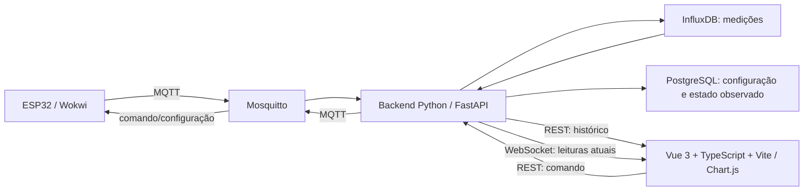

# Smart Fan IoT

Controle e acompanhamento do consumo estimado de um ventilador: evitar funcionamento esquecido, programar desligamento e visualizar energia/custo ao longo do tempo. O público inicial é o usuário residencial que deseja entender e reduzir desperdício; a simulação permite validar o fluxo antes de conectar um equipamento real.

Node 24 serve apenas às ferramentas e ao servidor de desenvolvimento do frontend. O backend é Python 3.11. PostgreSQL guarda configuração; as leituras históricas ficam no InfluxDB.

## Executar

Pré-requisitos: Docker Desktop iniciado, VS Code com PlatformIO e Wokwi. Node 24 e Python são necessários apenas para desenvolvimento fora dos containers.

1. Em [web-smart-fan-iot/](./web-smart-fan-iot/), crie o ambiente local a partir do [.env.example](./web-smart-fan-iot/.env.example), somente se ele ainda não existir. Substitua os placeholders por credenciais locais aleatórias. Nunca versione esse arquivo.
2. Execute `docker compose up -d --build` nesse diretório. Abra o dashboard em http://localhost:5173 e a API em http://localhost:8000/docs.
3. Em [esp32-simulador/](./esp32-simulador/), execute `pio run`, abra o firmware no VS Code e execute **Wokwi: Start Simulator**.
4. **Mantenha a aba do Wokwi ativa e em primeiro plano durante a validação integrada.** Uma simulação pausada interrompe a telemetria; WebSocket conectado sozinho não indica ESP32 online. Use um navegador separado para o painel sem ocultar o simulador.
5. Aguarde telemetria, ligue/desligue pelo dashboard e mova o potenciômetro. O estado só muda por retorno do ESP32, não pelo ACK do broker.

O potenciômetro simula a entrada analógica de corrente. A tensão de 127 V, escala de 0,8 A e fator de potência 0,90 são hipóteses da simulação, não medições calibradas. Zero permanece zero, sem consumo artificial. Antes de hardware real, será necessário um sensor elétrico apropriado e calibração. A aceitação acadêmica do potenciômetro como sensor simulado deve ser confirmada com o avaliador.

## Organização e contratos

- [Firmware e Wokwi](./esp32-simulador/README.md): circuito, configuração e comportamento local.
- [Aplicação web e infraestrutura](./web-smart-fan-iot/README.md): execução, portas, contratos MQTT/REST e qualidade.
- [Revisão original](./docs/revisao-tecnica-2026-10-26.md): diagnóstico anterior à implementação.
- [Validação da implementação](./docs/implementacao-2026-10-26.md): mudanças, evidências e limitações atuais.

Cada dispositivo tem um `device_id` com letras, números, `_` ou `-`, até 64 caracteres. Cadastre novos dispositivos em `POST /api/devices`; selecione-os no painel. Compile cada ESP32 com `FAN_DEVICE_ID` distinto. Sem seleção, o ID inicial é `esp32_fan_01`.

## Critério de sucesso

ON/OFF deve ser confirmado pelo dispositivo, gerar estado coerente no painel e leituras persistidas consultáveis. Coleta contínua deve manter cobertura correta após reduzir pontos para o gráfico. Falhas de broker não podem bloquear o desligamento local; ausência de dados deve ser distinguida de consumo zero.

## Segundo bimestre

1. Substituir corrente simulada por sensor adequado e validar calibração, unidades e relógio.
2. Ampliar dispositivos/sensores usando contratos validados; definir versão/sequência de telemetria quando houver necessidade de compatibilidade e deduplicação entre boots.
3. Implantar autenticação REST/WS, usuário/senha e ACL MQTT, TLS e gestão de segredos antes de disponibilizar fora da máquina local.
4. Implementar alertas guiados por requisitos reais, tarifa com vigência e cobertura mínima para projeções.
5. Definir retenção, migrações e recuperação durável; evoluir o monólito sem acrescentar serviços desnecessários.

O Docker atual é de desenvolvimento, com portas em loopback. Mosquitto continua anônimo nesse ambiente; frontend usa Vite dev e backend usa reload. Não é configuração de produção.
