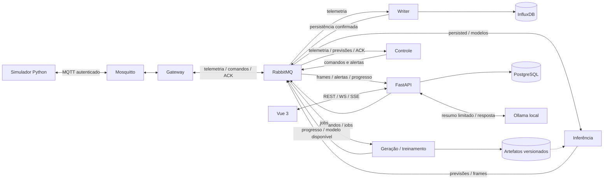

# Smart Fan IoT — Ventora AIoT

Monitoramento e controle de um ar-condicionado split simulado, com foco em desperdício de energia e manutenção preditiva do compressor. Evolução acadêmica do ventilador do primeiro bimestre, preservado em [ESP32/Wokwi](esp32-simulador/README.md) e no [Compose legado](web-smart-fan-iot/docker-compose.yml).

**Estado:** fluxos funcionais e UI demonstrados com um equipamento. O aceite de 19/11 teve interrupções na automação; o assistente permanece parcial por fidelidade semântica. Evidências e pendências no [aceite integrado](docs/aceite-integrado-2026-11-19.md).

## Arquitetura em execução



O diagrama mostra os fluxos de negócio; os serviços Python também usam PostgreSQL para estado e inbox/outbox. A entrega é ao menos uma vez, com deduplicação; não se presume execução física a partir de confirmação do broker.

| Serviço | Responsabilidade |
|---|---|
| `frontend` | Interface Vue, gráficos e cena 3D; encaminha `/api` e `/ws` à API |
| `api` | REST, autenticação/papéis, WS, chat SSE e consulta administrativa dos brokers |
| `simulator` | Cinco sensores, potência derivada, compressor e ventilador; estado/spool SQLite |
| `gateway` | Ponte MQTT ↔ RabbitMQ, com validação e confirmação durável |
| `writer` | Grava telemetria no InfluxDB e publica confirmação de persistência |
| `inference` | Calcula features causais e aplica os modelos ativos de saúde e RUL |
| `control` | Termostato, comandos, proteções e histerese de alertas |
| `jobs-worker` | Geração sintética e treinamento assíncronos, com progresso e cancelamento |
| `postgres` / `influxdb` | Estado transacional, usuários, regras e auditoria / séries temporais |
| `mosquitto` / `rabbitmq` | Transporte dos dispositivos / barramento interno e jobs |
| `ollama` | LLM local em CPU; recebe resumo, sem acesso direto aos bancos |

`volume-init`, `bootstrap` e `ollama-init` são processos de inicialização. Datasets e modelos ficam em volume de artefatos; sua identificação, aprovação e seleção ficam no PostgreSQL. A posição dos itens 3D pertence somente ao frontend.

### Fluxos principais

1. **IoT → Web:** simulador → MQTT → gateway → RabbitMQ → writer/InfluxDB → evento de persistência → inferência → RabbitMQ → API/WS → interface.
2. **Web → IoT:** botão → API → RabbitMQ → gateway → MQTT → simulador → ACK de execução e telemetria posterior. A interface distingue comando pendente de estado observado.
3. **IA:** laboratório → job RabbitMQ → dataset → treino → métricas/candidato → promoção administrativa sujeita à política → carga pela inferência sem reinício. Conclusão, aprovação, seleção desejada e versão ativa são estados distintos.

Exchanges topic: `smartfan.events`, `smartfan.jobs`, `smartfan.dlx`. Oito filas separam writer, inferência, controle, API, comandos, geração, treino e DLQ. Exemplos: `telemetry.quarto.hvac.ac_01`, `frame.ac_01` e `job.train`. Topologia e envelope versionado em [smartfan_common](packages/smartfan_common/src/smartfan_common/routing_v2.py).

## Dependências

| Camada | Tecnologias principais |
|---|---|
| Frontend | Vue 3, TypeScript 6, Vite 8, Vue Router, Chart.js 4, Three.js |
| Componentes | Reka UI, CVA, Lucide e Tailwind 4 com prefixo, sem reset global; composição inspirada em shadcn-vue |
| Backend | Python 3.11, FastAPI, Uvicorn, Pydantic, SQLAlchemy, psycopg2, Pika e Paho MQTT |
| IA | NumPy, SciPy, scikit-learn, Joblib; Ollama com `llama3.2:1b-instruct-q4_K_M` |
| Infraestrutura | PostgreSQL 15, InfluxDB 2, RabbitMQ 4 e Mosquitto 2, via Docker Compose |
| Desenvolvimento | Node 24, pytest, Ruff, mypy, Vitest e Playwright |

Node é usado somente nas ferramentas/build do frontend; API e workers são Python. Versões resolvidas estão em [package-lock.json](web-smart-fan-iot/frontend/package-lock.json), [requirements.lock](web-smart-fan-iot/backend/requirements.lock), [pacote compartilhado](packages/smartfan_common/pyproject.toml) e nas imagens do [Compose](compose.yaml). Não é necessário instalar bancos ou brokers diretamente no host.

## Organização do repositório

| Caminho | Conteúdo |
|---|---|
| [services/](services/) | API, simulador, gateway, writer, controle, inferência e jobs |
| [packages/smartfan_common/](packages/smartfan_common/) | Contratos, topologia, features compartilhadas e persistência confiável |
| [web-smart-fan-iot/frontend/src/aiot/](web-smart-fan-iot/frontend/src/aiot/) | Aplicação Vue atual; páginas, componentes e cena |
| [infra/](infra/) | Dockerfiles, bootstrap, migrações/provisionamento e configuração dos brokers |
| [tools/](tools/) | Preparação, verificações de qualidade e operação |
| [docs/](docs/) | Plano, ADRs, segurança e registros de implementação/aceite |
| [esp32-simulador/](esp32-simulador/) e [web-smart-fan-iot/](web-smart-fan-iot/) | Projeto do primeiro bimestre; Compose legado separado |

## Preparar e subir

Docker Desktop Linux/WSL2 ativo, pelo menos 8 GB disponíveis para Docker e Python com as dependências do projeto. Primeiro download de imagens/modelo exige internet; apresentações posteriores usam o cache.

Na raiz, em PowerShell:

```powershell
# Primeira preparação do ambiente de desenvolvimento:
python -m venv web-smart-fan-iot/backend/.venv
web-smart-fan-iot/backend/.venv/Scripts/python.exe -m pip install -r web-smart-fan-iot/backend/requirements-dev.txt
web-smart-fan-iot/backend/.venv/Scripts/python.exe -m pip install -e "./packages/smartfan_common[reliability]"
# Gera segredos privados sem sobrescrever e sobe tudo:
powershell -ExecutionPolicy Bypass -File tools/bootstrap/bootstrap.ps1 -Start
```

Com ambiente preparado: `docker compose up -d --build`. Abra **http://127.0.0.1:8080**. Confira `docker compose ps -a`: 13 serviços permanentes saudáveis; `volume-init`, `bootstrap` e `ollama-init` terminam com código zero. Sem modelo aprovado, a aplicação informa previsão indisponível.

O modelo local `llama3.2:1b-instruct-q4_K_M` tem digest fixado. A subida baixa/verifica o cache; o primeiro chat carrega o modelo sob exclusão com jobs pesados. A interface informa preparação. Sem fallback em nuvem.

Parar: `docker compose stop`; retomar: `docker compose up -d`. Não apagar volumes para recuperar serviços. Veja [infraestrutura](infra/README.md) e [backup/restore](tools/operations/README.md). O helper pontual `volume-init` usa root para ownership das raízes dos volumes; os serviços permanentes da aplicação não executam como root.

## Acesso e interfaces

| Conta inicial | Papel | Capacidades |
|---|---|---|
| `visualizador` | Visualizador | Dashboard, histórico, dispositivos, Insights, 3D e assistente |
| `operador` | Operador | Também comandos de atuadores |
| `admin` | Administrador | Também cadastro, usuários, regras, laboratório, treino, Mensageria e auditoria |

Não há senha fixa. O preparo gera arquivos privados `secrets/initial_viewer_password`, `secrets/initial_operator_password` e `secrets/initial_admin_password`, ignorados pelo Git. Consulte-os localmente, sem copiar valores para logs/documentação. Se alterada, vale a senha atual. JWT fica em memória: recarregar exige login. WS usa ticket único de 30 segundos, sem JWT na URL.

A página **Interfaces locais** apresenta RabbitMQ/InfluxDB. Habilite as portas opcionais somente em loopback:

```powershell
docker compose -f compose.yaml -f compose.dev.yaml up -d
```

RabbitMQ: http://127.0.0.1:15672; InfluxDB: http://127.0.0.1:8086. Sem override, somente o frontend está publicado. PostgreSQL não requer pgAdmin; consulte pelo terminal:

```powershell
docker compose exec postgres psql -U smartfan_bootstrap -d smartfan -c "SELECT id,name,enabled FROM app.device_registry;"
docker compose exec postgres psql -U smartfan_bootstrap -d smartfan -c "SELECT action,outcome,created_at FROM app.audit ORDER BY created_at DESC LIMIT 10;"
```

Documentação FastAPI: http://127.0.0.1:8080/api/v1/docs e `/api/v1/openapi.json`, sem CDN/Swagger externo. No InfluxDB, consulte bucket `live`, measurement `hvac_telemetry`, filtro `device_id=ac_01`.

## Roteiro com um equipamento

1. Mostrar `docker compose ps -a`, abrir a aplicação e conferir dados recentes de `ac_01`.
2. Entrar com três papéis; mostrar consulta do visualizador e controles de operador/admin.
3. Mostrar sensores Python e transporte: `docker compose logs --tail 10 simulator gateway`.
4. Abrir documentação FastAPI pela página Interfaces locais.
5. Na Mensageria, `docker compose stop writer`: observar fila crescer/consumidor zerar; `docker compose start writer`: aguardar drenagem. Prévias são metadados da fila API, até 100 por cinco minutos, não captura de todas as filas.
6. Consultar InfluxDB/PostgreSQL e abrir histórico da aplicação.
7. Mostrar gráfico/indicadores via WS. Conexão sozinha não significa sensor recente.
8. Na Visão geral, ligar/desligar ventilador, aguardar confirmação de execução e conferir o estado observado nas leituras seguintes; ACK de recebimento não basta. Liberar automático e observar termostato. Compressor respeita 180 s desligado, intertravamento e proteção térmica.
9. Laboratório padrão: 30 equipamentos sintéticos × 2 dias = **1.036.800 vetores**, com progresso. Equipamentos sintéticos de treino não são simuladores live adicionais.
10. Disparar treino; mostrar MAE/RMSE/R², baseline, previsto × real, importância e versão ativa. Candidato inferior é recusado; não forçar promoção nem anunciar desired como active.
11. Quando for demonstrar uma nova falha, preparar separadamente o [cenário de falha reproduzível](docs/cenario-demo.md), com suas alterações didáticas explicitadas; observar saúde/RUL, novo alerta e cores 3D; selecionar sensores, equipamento e atuadores.
12. Com job concluído, perguntar ao assistente sobre alerta, métricas da versão e arquitetura; abrir “Dados estruturados desta resposta” e conferir contra os dados estruturados.

Use login/API/Mensageria durante eventual espera anticiclo. Desligar ventilador mantém bloqueio até “Liberar automático”. Não executar testes que param serviços durante a apresentação.

## Verificação local e ensaio após UI/UX

Na raiz, execute os gates locais existentes (sem iniciar o runtime completo de cobertura/scans):

```powershell
web-smart-fan-iot/backend/.venv/Scripts/python.exe tools/quality/check.py lint
web-smart-fan-iot/backend/.venv/Scripts/python.exe tools/quality/check.py unit
web-smart-fan-iot/backend/.venv/Scripts/python.exe tools/quality/secret_scan.py tree
```

O Docker define `VITE_APP_MODE=aiot` no build. Se construir o frontend fora do Docker, defina essa variável antes de `npm run build`; sem ela, o projeto preserva o build legado.

Com a aplicação já saudável, o ensaio delimitado reutiliza dataset e modelo existentes. Executa comandos reais no ventilador e interrompe brevemente o writer para mostrar acúmulo/drenagem; restaura o automático e retoma o serviço em `finally`. Não cria contas, não apaga dados, não gera massa, não treina, não promove modelos e não chama o LLM. Exige `ac_01` inicialmente em automático e a senha administrativa atual no arquivo privado usado pelo teste. Não execute durante a apresentação:

```powershell
Set-Location web-smart-fan-iot/frontend
# Se necessário, instale apenas as ferramentas de desenvolvimento:
# npm ci
# npx playwright install chromium
$env:AIOT_CONSOLIDATION='1'
npx playwright test e2e/consolidation.spec.ts
Remove-Item Env:AIOT_CONSOLIDATION
Set-Location ../..
```

O ensaio completo permanece opt-in em [cenário de falha](docs/cenario-demo.md). Usa as três contas existentes, realiza parada/subida normal, cria um dataset/treino e usa volume adicional com configuração didática explícita; não é o comando padrão de validação visual. O chat real é verificado separadamente da fidelidade semântica, que continua parcial. O [aceite de 19/11](docs/aceite-integrado-2026-11-19.md) registra resultados e interrupções sem repetir a geração. Os demais testes reais de laboratório, treino, cena e assistente também podem criar jobs, atuar/parar serviços ou consumir o recurso do LLM: não executá-los indiscriminadamente como smoke test.

Resultados atuais, limites e instruções de demonstração ficam na [consolidação final](docs/consolidacao-final-2026-11-15.md). Unitários isolados não certificam os limiares de cobertura combinada/CI. Veja [qualidade](tools/quality/README.md), [API](services/api/README.md), [Mensageria](services/api/MESSAGING.md) e [treinamento](services/jobs/TRAINING.md).

## Limites preservados

- Física, saúde e RUL são sintéticas, sem calibração real; RUL é em horas de calendário do cenário de treino.
- Dado antigo, compressor parado ou janela insuficiente não gera previsão inventada; cena sem dados congela e fica cinza.
- Chat e jobs pesados não são simultâneos. Modelo pequeno pode interpretar dados incorretamente; valores oficiais são estruturados.
- No ensaio de 14/11, os 12 passos funcionais passaram, mas o texto do assistente foi reprovado. Por decisão do usuário, 1B mantido provisoriamente e assistente registrado como atendimento parcial, com pendência de fidelidade semântica; avaliação de modelos encerrada nesta etapa. Os demais componentes permanecem concluídos no escopo validado. Veja a [comparação](docs/avaliacao-llm-2026-11-14.md).
- Carga ampliada permanece reprovada/não revalidada; p95 prolongado, falhas combinadas e automação de backups adiados. Prioridade: um equipamento.
- Replay restrito ao writer, agenda, revisões e gestão de usuários preservados, sem expansão.
- Credenciais históricas permanecem no Git; rejeição verificada somente nos emissores locais conhecidos. Veja [segurança](docs/security/README.md).
- [Plano/registros](docs/PLANO-BIMESTRE-2.md) distinguem evidência antiga de atual; [ADRs](docs/adr/) orientam as escolhas. Publicação remota não condiciona aceite local.
