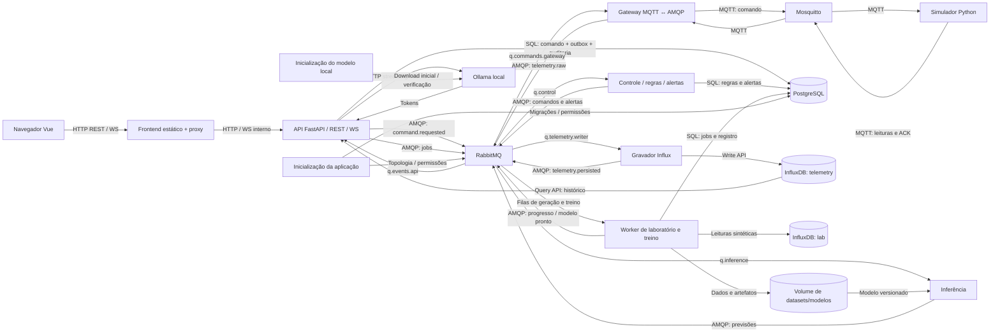
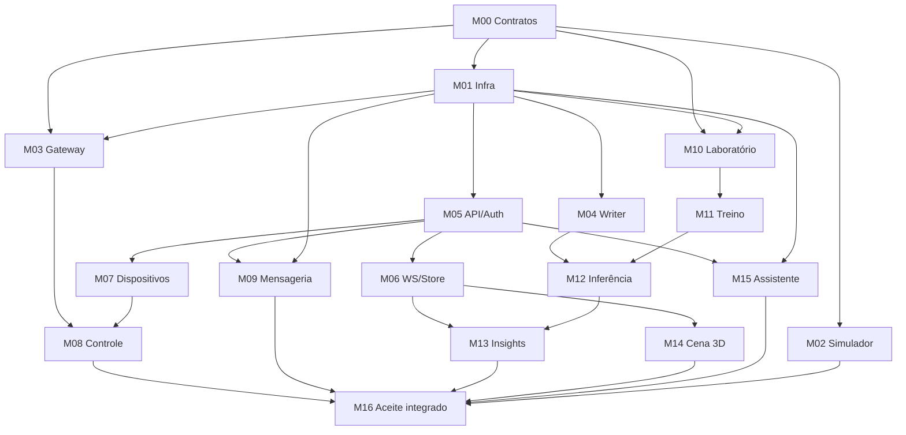

# Plano do 2º bimestre — Smart Fan IoT / AIoT

Data: 26/10/2026. Referência do repositório: branch `feature/dashboard-energy-v2`, commit `adb9815`.

**Status:** plano aprovado e implementação posteriormente autorizada no chat. O M00 foi implementado como núcleo compartilhado; os módulos seguintes continuam pendentes. Não há cronograma, divisão de integrantes ou backlog de issues neste plano.

**Forma de trabalho:** seguir o plano aprovado, validar mudanças sempre que possível e manter commits separados. O limite de blocos de 15 minutos foi retirado explicitamente pelo usuário. Os ADRs permanecem incorporados a este documento.

**Entrega M00:** [núcleo compartilhado](../packages/smartfan_common/README.md) com contratos Pydantic, JSON Schema, tipos/validação TypeScript, fixtures comuns, topologia declarativa e extração causal de 18 features. Validação: 65 testes do pacote Python, 154 testes frontend, Ruff, mypy, ESLint, Prettier, geração sem divergências, compilação Vue/TypeScript e build Vite aprovados; `npm audit` sem vulnerabilidades reportadas. Os 153 testes do backend existente também passaram. Esta entrega não migra o fluxo operacional nem sobe RabbitMQ ou os serviços dos módulos seguintes.

**Decisões confirmadas pelo usuário:** ar-condicionado split convencional liga/desliga como referência; mesma máquina para execução/apresentação; avaliação técnica da unidade de RUL; ADRs no próprio plano.

## 1. Estado atual e reaproveitamento

A base já tem FastAPI, PostgreSQL, MQTT bidirecional, InfluxDB, WebSocket, dashboard Vue e regras de energia. O principal salto será transformar o fluxo direto do backend em um fluxo orientado a mensagens, acrescentando segurança, simulação física, laboratório, modelos e visualização 3D.

O problema continuará relacionado a consumo energético, controle e prevenção de desperdício residencial. A manutenção preditiva será uma evolução dessa proposta. Não há diagnóstico de degradação de ar-condicionado implementado hoje.

### Inventário resumido — profundidade 3

- [README.md](../README.md) — problema, execução e visão geral.
- [docs/](./)
  - [revisao-tecnica-2026-10-26.md](./revisao-tecnica-2026-10-26.md) — diagnóstico anterior.
  - [implementacao-2026-10-26.md](./implementacao-2026-10-26.md) — correções e validações realizadas.
- [esp32-simulador/](../esp32-simulador/)
  - [src/](../esp32-simulador/src/)
    - [main.cpp](../esp32-simulador/src/main.cpp) — dispositivo atual.
  - [platformio.ini](../esp32-simulador/platformio.ini), [diagram.json](../esp32-simulador/diagram.json) e [wokwi.toml](../esp32-simulador/wokwi.toml) — compilação e simulação.
- [tools/](../tools/)
  - [verify_wokwi.py](../tools/verify_wokwi.py) — teste integrado específico do Wokwi.
- [web-smart-fan-iot/](../web-smart-fan-iot/)
  - [backend/](../web-smart-fan-iot/backend/)
    - [app/](../web-smart-fan-iot/backend/app/) — API, MQTT, energia, bancos e scheduler.
    - [tests/](../web-smart-fan-iot/backend/tests/) — validação, domínio e fronteiras.
    - [requirements.lock](../web-smart-fan-iot/backend/requirements.lock) — versões resolvidas.
  - [frontend/](../web-smart-fan-iot/frontend/)
    - [src/](../web-smart-fan-iot/frontend/src/) — interface, componentes, comunicação e regras de gráficos.
    - [package.json](../web-smart-fan-iot/frontend/package.json) — dependências e verificações.
  - [mosquitto/](../web-smart-fan-iot/mosquitto/)
    - [config/](../web-smart-fan-iot/mosquitto/config/) — configuração atual do broker.
  - [docker-compose.yml](../web-smart-fan-iot/docker-compose.yml) e [.env.example](../web-smart-fan-iot/.env.example).

### Stack e entrypoints atuais

| Parte | Estado real |
|---|---|
| API | FastAPI já implementado em [main.py](../web-smart-fan-iot/backend/app/main.py), executado por Uvicorn |
| Python | Imagem Python 3.11; lock com FastAPI 0.162.0, SQLAlchemy 2.0.55, Pydantic 2.14.1, influxdb-client 1.50.0 e Paho 1.6.1 |
| Frontend | Vue 3, TypeScript 6, Vite 8 e Chart.js 4; montagem em [main.ts](../web-smart-fan-iot/frontend/src/main.ts) |
| Dispositivo | Arduino/ESP32, plataforma espressif32 6.12.0, ArduinoJson e PubSubClient |
| Infra | Mosquitto 2.0, PostgreSQL 15, InfluxDB 2.7, backend e frontend |
| Qualidade | pytest, Ruff, mypy, Vitest, ESLint e Prettier configurados |
| Git | Branch `feature/dashboard-energy-v2`, HEAD `adb9815`, árvore limpa antes de criar este documento |
| CI | Não foi encontrado workflow de CI versionado no inventário analisado |

A validação anterior registrou 153 testes Python e 104 frontend passando. Eles não foram reexecutados neste planejamento. O frontend é compilado e servido em desenvolvimento com Node 24; **Node.js não é backend**.

Dependências declaradas: [requirements.txt](../web-smart-fan-iot/backend/requirements.txt), [requirements-dev.txt](../web-smart-fan-iot/backend/requirements-dev.txt), [requirements.lock](../web-smart-fan-iot/backend/requirements.lock), [package.json](../web-smart-fan-iot/frontend/package.json) e [package-lock.json](../web-smart-fan-iot/frontend/package-lock.json).

Os Dockerfiles atuais usam Uvicorn com reload e Vite dev: [backend](../web-smart-fan-iot/backend/Dockerfile), [frontend](../web-smart-fan-iot/frontend/Dockerfile). Não são configuração final de produção.

### Contratos atuais

- MQTT: `devices/{id}/telemetry`, `/command`, `/state`, `/config` e `/config/set`.
- Telemetria elétrica: corrente, tensão, potência, estado e informações temporais, conforme [schemas.py](../web-smart-fan-iot/backend/app/schemas.py).
- InfluxDB: measurement `electrical_measurement`, tag `device_id`, fields `is_on`, `current_a`, `power_w`, `voltage_rms` e epoch opcional do dispositivo. O timestamp do ponto é de recepção capturado pelo backend.
- PostgreSQL: somente o modelo [Device](../web-smart-fan-iot/backend/app/models.py), com configuração, tarifa e estado observado.
- WS: `/ws`, com validação de origem, mas sem autenticação por usuário.
- Frontend: aplicação concentrada em [App.vue](../web-smart-fan-iot/frontend/src/App.vue), sem roteador de páginas identificado nas dependências atuais. Inclui Brand, MetricCard, PeriodSelector, PowerChart, ScheduleCard, StatusCard, TariffCard e ThemeToggle em [components/dashboard/](../web-smart-fan-iot/frontend/src/components/dashboard/).
- Estado de conexão e validação runtime em [useWebSocket.ts](../web-smart-fan-iot/frontend/src/composables/useWebSocket.ts) e [realtime.ts](../web-smart-fan-iot/frontend/src/lib/realtime.ts).

Endpoints atuais, declarados em [main.py](../web-smart-fan-iot/backend/app/main.py):

| Método | Rota | Responsabilidade |
|---|---|---|
| GET | `/health` | Estado do processo e conexão MQTT |
| GET / POST | `/api/devices` | Listar e cadastrar dispositivos |
| GET | `/api/device/{device_id}` | Consultar configuração e estado |
| POST | `/api/device/{device_id}/command` | Solicitar ON/OFF |
| PUT | `/api/device/{device_id}/schedule` | Atualizar horário, habilitação e tarifa |
| PUT | `/api/device/{device_id}/auto-shutdown` | Atualizar desligamento |
| PUT | `/api/device/{device_id}/tariff` | Atualizar tarifa |
| GET | `/api/device/{device_id}/metrics` | Histórico, energia, cobertura e segmentos |
| WS | `/ws` | Telemetria e eventos de estado/configuração |

O histórico recebe `range_hours` ou `start/end`, além de `max_points`; possui limite de intervalo e de leitura bruta. O schema atual não contém temperatura ou vibração.

### Classificação do código

As categorias são Reaproveitar como está, Adaptar, Substituir e Descartar. Preservação histórica é uma observação, não uma categoria adicional.

| Parte atual | Classificação | Motivo |
|---|---|---|
| Integração de energia e cobertura | Reaproveitar como está | Regras independentes do ventilador; preservar testes e semântica |
| Formatação, tema e componentes visuais genéricos | Reaproveitar como está | Úteis no novo equipamento |
| API REST e schemas | Adaptar | Acrescentar autenticação, equipamento HVAC, jobs, modelos e contratos |
| Modelo Device e banco PostgreSQL | Adaptar | Faltam usuários, regras, comandos, auditoria e registros de laboratório |
| Cliente InfluxDB e consultas | Adaptar | Separar leitura, gravação, dados HVAC e laboratório |
| Cliente REST e WebSocket Vue | Adaptar | Ticket, store compartilhada, novos eventos e novas páginas |
| Dashboard e gráfico | Adaptar | Acrescentar sensores, saúde, RUL e contexto operacional |
| Scheduler | Adaptar | Tornar-se regras de controle com histerese e intertravamentos |
| Subscriber MQTT dentro da API | Substituir | Gateway e gravador independentes assumirão suas responsabilidades |
| ESP32/Wokwi no fluxo principal | Substituir | Simulador Python será o dispositivo padrão; preservar firmware/circuito como referência |
| Teste específico do Wokwi no aceite principal | Substituir | Acrescentar teste do simulador Python; manter o teste antigo como referência |
| Dockerfiles e Compose | Adaptar | Novos consumidores, usuários, segredos, frontend estático e non-root |
| Documentação e exemplos de ambiente | Adaptar | Refletir arquitetura e configuração novas |
| READMEs de scaffolding sem função | Descartar quando confirmado | Remover apenas material comprovadamente residual |

## 2. Lacunas frente aos 20 requisitos

“Atende” significa que a capacidade básica existe hoje, não que dispense adaptação para HVAC.

| # | Requisito | Hoje | Evidência | O que falta |
|---|---|---|---|---|
| 1 | Vue/React + TS + Vite | Atende | [package.json](../web-smart-fan-iot/frontend/package.json) | Novas páginas e navegação |
| 2 | Python/FastAPI REST | Atende | [API](../web-smart-fan-iot/backend/app/main.py) | Expandir contratos e segurança |
| 3 | WebSocket | Atende | [WS](../web-smart-fan-iot/backend/app/main.py) | Ticket, autorização e novos eventos |
| 4 | MQTT bidirecional | Atende | [MQTTManager](../web-smart-fan-iot/backend/app/mqtt_service.py) | Gateway, ACL e ACK de aplicação |
| 5 | ≥3 sensores | Parcial | Telemetria elétrica atual | Cinco sensores HVAC simulados |
| 6 | ≥2 atuadores | Parcial | Comando ON/OFF atual | Compressor e ventilador externo independentes |
| 7 | Equipamento com ≥3 variáveis de degradação | Parcial | Equipamento atual é ventilador | Modelo físico simplificado de degradação |
| 8 | Acionamento automático | Parcial | [Scheduler](../web-smart-fan-iot/backend/app/scheduler.py) | Termostato, proteção e histerese |
| 9 | Controle direto pela Web | Atende | Comandos atuais | Comandos HVAC e intertravamentos |
| 10 | RabbitMQ e tela de Mensageria | Não existe | Ausente no [Compose](../web-smart-fan-iot/docker-compose.yml) | Topologia, consumidores, DLQ e monitoramento |
| 11 | PostgreSQL + InfluxDB com papéis completos | Parcial | Bancos e Device existentes | Novas entidades e isolamento de laboratório |
| 12 | Dashboard e histórico | Atende | Dashboard atual | Variáveis HVAC e insights |
| 13 | Gerenciamento de dispositivos | Parcial | Criar/listar/consultar | Editar, desativar, configurar sensores e atuadores |
| 14 | Cena 3D por WS | Não existe | Sem biblioteca/cena identificada | Three.js e vínculo exclusivo com dados recentes |
| 15 | Gerador massivo | Não existe | Ausente no backend | Jobs, NumPy em blocos, verdade isolada e controles |
| 16 | Dois regressores e avaliação | Não existe | Sem scikit-learn | Features, split, treino, métricas e registro |
| 17 | Saúde, RUL e alertas preditivos | Não existe | Sem pipeline de inferência | Inferência, qualidade e histerese |
| 18 | Assistente LLM local | Não existe | Sem Ollama | Container, streaming, contexto e auditoria |
| 19 | Compose completo | Parcial | Cinco serviços atuais | Stack-alvo e inicializadores |
| 20 | GitHub e README completos | Parcial | Histórico e documentação existentes | Documentação do novo escopo, CI e contribuições reais |

## 3. Equipamento, sensores e degradação

### Modelo do equipamento

Um split convencional contém unidade interna e unidade externa. O simulador representará o comportamento necessário para controle e demonstração, sem tentar reproduzir um ciclo frigorífico completo.

Os cinco sensores serão:

| Campo proposto | Grandeza |
|---|---|
| `current_a` | Corrente eficaz da unidade externa |
| `compressor_case_temp_c` | Temperatura da carcaça do compressor |
| `vibration_rms_mm_s` | Vibração RMS do compressor/conjunto externo |
| `indoor_temp_c` | Temperatura ambiente interna |
| `outdoor_temp_c` | Temperatura ambiente externa |

“Condensador” é o trocador de calor; “unidade condensadora” é o conjunto externo. Temperatura da carcaça não será apresentada como temperatura dos enrolamentos internos.

A potência continuará disponível como estimativa derivada do modelo elétrico. Tensão e fator de potência serão parâmetros explícitos do equipamento, sem contar como sensores adicionais.

### Atuadores e regras

| Atuador | Controle pela Web | Controle automático |
|---|---|---|
| Compressor | Solicitação ON/OFF em modo manual | Termostato e proteção |
| Ventilador externo | Comando permitido nas condições previstas pelo modelo | Acompanhamento do compressor e proteção térmica |

O simulador validará o comando antes de aplicá-lo. Compressor ligado sem ventilação externa será uma condição proibida. Comandos também respeitarão tempos mínimos configurados entre partidas.

Os estados desejado, comandado e observado serão distintos. A interface só mostrará o estado físico simulado após o retorno do dispositivo.

### Cenários propostos

| Cenário | Efeitos esperados no modelo |
|---|---|
| Operação saudável | Variações por temperatura externa, carga térmica e ciclo de funcionamento |
| Desgaste mecânico progressivo | Aumento de vibração, aquecimento e alteração da corrente sob condições comparáveis |
| Perda de troca térmica | Aquecimento externo, aumento de esforço e redução da velocidade de resfriamento interno |

Essas relações serão hipóteses documentadas do gerador. Não será obrigatório fazer todos os sensores aumentarem juntos: isso produziria dados artificiais demais. Temperatura externa elevada, por exemplo, não deve virar automaticamente um diagnóstico de falha.

A relação entre manutenção, eficiência e tempo de funcionamento é coerente com o problema original; não constitui validação do nosso simulador. Referência: [ENERGY STAR — manutenção](https://www.energystar.gov/saveathome/heating-cooling/maintenance-checklist).

### RUL e saúde

**Alvo principal:** horas equivalentes de operação do compressor até atingir um limite operacional definido no cenário sintético.

O limite poderá representar incapacidade de manter a capacidade mínima ou uma condição sustentada de temperatura/vibração fora do cenário aceitável.

- RUL não será apresentada como previsão validada da vida de um aparelho real.
- O regime futuro assumido para calcular os rótulos será registrado no dataset.
- Saúde de 0–100 será um indicador separado e explicável, não uma “probabilidade de falha” inventada.
- Sem janela suficiente, dados recentes ou modelo válido, a resposta será “indisponível” ou “aquecendo”, em vez de um número arbitrário.

O relógio dos eventos ao vivo será UTC. Energia e custo não usarão silenciosamente um relógio acelerado de laboratório.

Referência de conceito: [NASA — Prognostics/RUL](https://data.nasa.gov/dataset/prognostics).

## 4. Arquitetura-alvo

A proposta mantém **uma aplicação FastAPI**. Os demais processos Python são consumidores especializados, sem criar uma API HTTP para cada função.



O evento `telemetry.persisted` representa uma amostra cuja gravação foi confirmada. Ele transportará as informações necessárias à projeção de tempo real; a API não precisará consultar o Influx para cada mensagem.

Regras de proteção podem consumir telemetria validada antes da persistência, para não depender da disponibilidade do histórico.

### Serviços do Compose

| Serviço | Responsabilidade | Portas | Dependências e healthcheck |
|---|---|---|---|
| `frontend` | SPA e proxy de REST/WS | Única porta pública normal: 8080 | Resposta HTTP |
| `api` | REST, autenticação, WS, auditoria e assistente | 8000 interna | PostgreSQL, RabbitMQ e inicialização; readiness |
| `simulator` | Física simplificada, sensores e atuadores | Sem porta HTTP | MQTT conectado e loop ativo |
| `gateway` | Conversão MQTT↔AMQP | Sem porta pública | Conexões com ambos os brokers |
| `writer` | Persistência idempotente de telemetria | Sem porta pública | RabbitMQ e Influx; heartbeat do consumidor |
| `control` | Regras, comandos automáticos e alertas | Sem porta pública | RabbitMQ e PostgreSQL |
| `inference` | Features ao vivo e predição | Sem porta pública | RabbitMQ, artefatos e acesso de leitura necessário |
| `jobs-worker` | Geração e treinamento, um job por vez | Sem porta pública | RabbitMQ, PostgreSQL, Influx lab e artefatos |
| `mosquitto` | Broker dos dispositivos | 1883 interna | Conexão autenticada de verificação |
| `rabbitmq` | Barramento e filas | 5672/15672 internas | Diagnóstico do broker e topologia inicializada |
| `postgres` | Dados transacionais | 5432 interna | `pg_isready` |
| `influxdb` | Séries temporais | 8086 interna | Endpoint de saúde |
| `ollama` | Inferência local do assistente | 11434 interna | API disponível |
| `init-app` | Migrações, configuração inicial e validações | Sem porta | Execução única bem-sucedida |
| `ollama-init` | Preparar/verificar modelo e cache | Sem porta | Execução única; volume persistente |

As UIs administrativas de RabbitMQ, Influx e eventual pgAdmin poderão existir em um perfil de diagnóstico, publicadas exclusivamente em `127.0.0.1`.

Todos os processos deverão rodar com UID não zero. Os usuários e permissões dos volumes serão preparados conforme cada imagem; não será aplicado um UID arbitrário igual a todas elas.

### Dimensionamento

A referência é a máquina atual: aproximadamente 16 GB de RAM no host e 7,6 GiB disponíveis ao Docker, observados durante a análise.

- Um job pesado de geração/treinamento por vez.
- Uma solicitação de LLM por vez.
- Contexto e saída do LLM limitados.
- Concorrência entre treino e LLM controlada, sem bloquear ingestão e controle.
- Limites de memória e threads definidos por medição.
- Desempenho e consumo dessa stack completa permanecem **não verificados**.

## 5. Organização proposta

A recomendação é preservar os diretórios principais e acrescentar módulos, evitando uma mudança geral de nomes. A árvore da seção 1 representa o estado anterior; esta é a árvore-alvo proposta:

```text
smart-fan-iot/
├── esp32-simulador/                 # referência histórica, fora do Compose padrão
├── packages/
│   └── smartfan_common/
│       ├── contracts/              # envelopes, payloads e unidades
│       ├── features/               # implementação compartilhada
│       └── physics/                # observações e modelo sintético comum
├── web-smart-fan-iot/
│   ├── backend/
│   │   ├── app/
│   │   │   ├── api/
│   │   │   ├── gateway/
│   │   │   ├── writer/
│   │   │   ├── control/
│   │   │   ├── inference/
│   │   │   ├── lab/
│   │   │   └── assistant/
│   │   ├── migrations/
│   │   └── tests/
│   ├── frontend/
│   │   └── src/
│   │       ├── pages/
│   │       ├── stores/
│   │       ├── scene/
│   │       └── components/
│   ├── simulator/
│   ├── infra/
│   │   └── rabbitmq/
│   ├── mosquitto/
│   └── docker-compose.yml
├── tools/
└── docs/
```

A física pode compartilhar código, mas o estado latente de degradação não será serializado junto das observações públicas.

Duas imagens Python são suficientes:

- **Core:** API, gateway, gravador, controle e simulador.
- **ML:** derivada da base compatível, acrescentando dependências de treinamento/inferência.

Treino e inferência usarão versões compatíveis e fixadas de Python, NumPy, scikit-learn e do pacote compartilhado. A compatibilidade das versões-alvo será verificada ao implementar os módulos; não foi instalada uma stack ML neste planejamento.

## 6. Contratos e mensageria

### Envelope único

Exemplo de proposta, sem valores de segredo:

```json
{
  "schema_version": "1.0",
  "id": "b7b4d8ec-8b91-4a0a-9d51-56bf65fa1448",
  "timestamp": "2026-10-26T15:00:00Z",
  "type": "telemetry.sampled",
  "stream": "live",
  "device_id": "ac_01",
  "zone": "lab_a",
  "equipment_type": "ac_split_onoff",
  "metadata": {
    "producer": "simulator",
    "boot_id": "8b82d847-106a-4416-b1eb-68ff09dd3652",
    "sequence": 1420,
    "correlation_id": null,
    "causation_id": null
  },
  "data": {
    "readings": {
      "current_a": 5.2,
      "compressor_case_temp_c": 67.0,
      "vibration_rms_mm_s": 2.1,
      "indoor_temp_c": 25.3,
      "outdoor_temp_c": 32.0,
      "power_w": 1030.0
    },
    "actuators": {
      "compressor_on": true,
      "condenser_fan_on": true
    },
    "quality": {
      "missing_fields": []
    }
  }
}
```

Os números são apenas ilustrativos.

O envelope será comum; o conteúdo de `data` terá schema específico por `type`. Jobs poderão ter `device_id` nulo. Comandos terão prazo de validade, identificação e estado desejado explícito.

Regras essenciais:

- UTC e unidades documentadas.
- IDs preservados em retries.
- Sequência por dispositivo/boot.
- Sem `NaN` ou `Infinity` em JSON.
- Campos ausentes não viram zero.
- `stream=lab` não pode entrar nas rotas de telemetria ao vivo.
- Rótulos de verdade, dano latente e instante futuro de falha são proibidos nos payloads live.
- Eventos derivados identificam a amostra original e sua causalidade.

### Topologia RabbitMQ

Vhost dedicado ao projeto.

| Exchange | Tipo | Uso |
|---|---|---|
| `smartfan.events` | topic | Telemetria, comandos, previsões, alertas e estados |
| `smartfan.jobs` | topic | Geração e treinamento |
| `smartfan.dlx` | topic | Mensagens mortas |

| Fila | Binding principal | Consumidor |
|---|---|---|
| `q.telemetry.writer` | `telemetry.raw.#` | Gravador Influx |
| `q.control` | `telemetry.raw.#`, `insight.predicted.#` | Controle/regras |
| `q.inference` | `telemetry.persisted.#`, `model.activate.#` | Inferência |
| `q.commands.gateway` | `command.requested.#` | Gateway |
| `q.events.api` | Persistência, previsões, alertas, comandos e progresso | API/WS |
| `q.jobs.generate` | `dataset.generate` | Worker de jobs |
| `q.jobs.train` | `model.train` | Worker de jobs |
| `q.dlq` | Mensagens encaminhadas pela DLX | Inspeção administrativa |

Os bindings da fila da API serão explicitados por tipos autorizados ao fechar os contratos. Geração e treinamento têm filas distintas, mas podem compartilhar um processo com limite global de um job ativo. Há mais de quatro filas com consumidores de responsabilidades distintas, independentemente da DLQ.

Exemplos de routing keys:

```text
telemetry.raw.lab_a.hvac.ac_01
telemetry.persisted.lab_a.hvac.ac_01
command.requested.lab_a.hvac.ac_01
command.applied.lab_a.hvac.ac_01
insight.predicted.lab_a.hvac.ac_01
alert.raised.lab_a.hvac.ac_01
```

### Garantias de entrega

- Exchanges e filas duráveis; mensagens persistentes.
- Publisher confirms e ACK manual.
- Prefetch limitado; inicialmente 1 para jobs demorados.
- Sem promessa de exactly-once.
- Escrita Influx idempotente para reentrega da mesma amostra.
- Comandos idempotentes por ID e revisão; evitar comandos “toggle”.
- API/control registram comando, auditoria e outbox na mesma transação.
- ACK do broker não é confirmação do atuador.

Publisher confirms e ACK de consumidor resolvem etapas diferentes da entrega; essa distinção será preservada. Referência: [RabbitMQ — confirms e acknowledgements](https://www.rabbitmq.com/docs/confirms).

Mensagens inválidas seguem para DLQ. Indisponibilidade temporária de infraestrutura deve provocar pausa/backoff do consumidor, evitando tanto perda silenciosa quanto loop de requeue sem espera.

Comandos vencidos nunca serão executados por replay. Reprocessamento de DLQ será administrativo e auditado. O comportamento da DLX deve ser verificado na versão de broker escolhida: [documentação oficial](https://www.rabbitmq.com/docs/dlx).

### Usuários RabbitMQ

Um usuário próprio para cada serviço consumidor/publicador: API, gateway, writer, control, inference e jobs-worker, além da identidade de inicialização.

- Sem `guest`.
- Sem credencial administrativa compartilhada pelas aplicações.
- Permissões de recurso e de tópico.
- O worker de laboratório não poderá publicar telemetria live.
- A API terá acesso de monitoramento restrito ao vhost necessário.

A distinção entre permissões de recursos e permissões de tópicos é importante para impedir que um serviço com acesso ao exchange publique qualquer tipo de evento. Referência: [controle de acesso RabbitMQ](https://www.rabbitmq.com/docs/access-control).

### MQTT e ACL

Manter uma convenção próxima da atual:

```text
devices/{id}/telemetry
devices/{id}/commands
devices/{id}/acks
devices/{id}/state
devices/{id}/availability
```

- Telemetria e comandos em QoS 1.
- Comandos sem retain.
- Estado/configuração retained quando apropriado.
- LWT de disponibilidade.
- Credenciais próprias por dispositivo lógico.
- Simulador publica somente seus tópicos e lê seus comandos.
- Gateway lê telemetria/ACK/estado e publica comandos.
- Acesso anônimo desabilitado.

A identidade da ACL será baseada na credencial autenticada, não apenas em um `client_id` escolhido pelo cliente. Referência: [Mosquitto](https://www.mosquitto.org/man/mosquitto-conf-5.html).

## 7. Bancos, tempo e persistência

### PostgreSQL

| Entidade | Responsabilidade |
|---|---|
| `users`, sessões e tentativas de login | Identidade, papel e proteção de autenticação |
| `devices`, sensores e atuadores | Cadastro e capacidades |
| `device_settings` | Setpoint, modo e parâmetros |
| `rules` | Regras e limites |
| `commands`, `outbox` | Solicitação, entrega, aplicação e expiração |
| `alerts` | Estado dos alertas e reconhecimento |
| `audit_events` | Ações e resultados |
| `jobs`, `datasets` | Execução e configuração dos jobs |
| `model_versions`, implantação ativa | Artefatos, métricas e versão |
| `ws_tickets` | Ticket curto, hash, validade e consumo |

Aplicar migrações versionadas. Dados antigos não serão apagados para adaptar o schema.

### InfluxDB

| Bucket | Conteúdo |
|---|---|
| `telemetry` | Leituras operacionais HVAC e estados observados |
| `lab` | Leituras sintéticas de datasets identificados |

Proposta:

- Measurement novo para telemetria HVAC.
- Tags com cardinalidade controlada: dispositivo, zona e tipo; no laboratório, dataset/equipamento sintético.
- Corrente, temperaturas, vibração, potência, estados e qualidade como fields.
- ID de evento e sequência não serão tags de cardinalidade ilimitada.
- Tempo da observação e tempo de recepção distintos.
- Reentregas usam o timestamp original.
- Eventos antigos da fila não tornam a cena “online” apenas por terem sido entregues agora.

Os dados elétricos anteriores podem continuar consultáveis; não há necessidade de reinterpretar medições antigas como HVAC.

### Verdade do laboratório

Os rótulos ficarão em artefatos separados das observações:

- Arquivos NumPy em volume de datasets.
- Manifesto com seed, configuração, versões, equipamentos, checksum e split.
- Acesso por funções de treinamento e endpoints autorizados.
- Nenhum envio de rótulos por MQTT ou WS operacional.

A tela de previsto×real poderá consultar resultados do laboratório por REST. O WS de jobs transportará progresso e identificação de artefatos, sem transmitir rótulos individuais.

## 8. Laboratório e modelos

### Geração massiva

Definição de aceite: **um milhão de registros temporais**, cada um contendo as cinco grandezas previstas, e não apenas a soma da contagem dos campos.

Configuração pela UI:

- Quantidade de registros/equipamentos.
- Intervalo de amostragem.
- Seed.
- Cenários e intensidade de degradação.
- Ruído, faltantes e outliers.
- Perfis de carga e temperatura externa.
- Tamanho dos blocos.

A geração usará NumPy em blocos, sem materializar um milhão de dicionários Python simultaneamente. Arrays mapeados em disco são uma opção suficiente para esta escala: [NumPy open_memmap](https://numpy.org/doc/stable/reference/generated/numpy.lib.format.open_memmap.html).

O job terá progresso, cancelamento cooperativo e conclusão somente após validar contagens/artefatos. Uma execução parcial não será oferecida como dataset completo.

Streams pseudoaleatórios independentes por equipamento reduzem acoplamento entre simulações; seed, configuração e versões serão registradas. Referência: [NumPy SeedSequence](https://numpy.org/doc/stable/reference/random/parallel.html).

### Features compartilhadas

Um único módulo implementará as features para batch e online:

- Médias, dispersão, máximos e tendências em janelas passadas.
- Temperatura da carcaça relativa à temperatura externa.
- Comportamento térmico interno condicionado ao compressor.
- Corrente e vibração contextualizadas pelo estado de operação.
- Cobertura e indicadores de faltantes.
- Tratamento explícito de partida, desligamento e janela incompleta.

Não serão usados como entrada: RUL verdadeira, dano latente, instante futuro de falha ou identificador do equipamento para memorizar seu destino.

Não será apresentada análise espectral de rolamentos a partir de um único valor RMS por amostra.

### Treinamento e avaliação

Modelos candidatos:

1. Ridge, com pré-processamento adequado.
2. HistGradientBoostingRegressor.

Baseline separado: `DummyRegressor`, por exemplo com mediana aprendida no treino.

- Treino, validação e teste separados por equipamento.
- Todas as janelas/episódios do mesmo equipamento permanecem no mesmo conjunto.
- Pré-processamento ajustado somente no treino.
- Nenhuma janela olha o futuro.
- Validação interna também deve respeitar grupos; não usar uma divisão aleatória escondida por linha.
- MAE, RMSE e R² globais e por equipamento/cenário.
- Previsto×real, erros e comparação com baseline.
- Importância por permutação em amostra de validação, com tamanho limitado.

A divisão por grupos impede que observações do mesmo equipamento apareçam no treino e no teste: [scikit-learn GroupShuffleSplit](https://scikit-learn.org/stable/modules/generated/sklearn.model_selection.GroupShuffleSplit.html).

A importância por permutação permite uma comparação consistente entre os dois modelos: [scikit-learn](https://scikit-learn.org/stable/modules/permutation_importance.html).

Treino concluído não significará implantação automática: um candidato que não supera o baseline deve ficar registrado, com motivo de rejeição.

### Registro e hot-reload

Cada versão terá:

- Dataset e split utilizados.
- Versão das features.
- Versões das bibliotecas.
- Métricas, parâmetros e checksum.
- Estado candidato/aprovado/rejeitado/ativo.

O processo de inferência carregará e validará o novo artefato antes de trocar a referência ativa. A UI mostrará a versão realmente carregada. Uma falha manterá a versão anterior.

Artefatos de modelo serão produzidos pelos serviços confiáveis; upload e carregamento arbitrário de arquivos serializados ficam fora do escopo inicial. Referência: [persistência de modelos scikit-learn](https://scikit-learn.org/stable/model_persistence.html).

### Inferência e alertas

- Buffers de janela limitados por equipamento e boot.
- Abstenção quando faltarem dados ou compatibilidade.
- Previsão vinculada ao timestamp e à versão do modelo.
- Alertas com entrada, saída, persistência mínima e cooldown.
- Eventos antigos não acionam uma regra nova como se fossem atuais.
- Reconhecer um alerta não remove a condição que o originou.

## 9. Segurança, frontend e assistente

### Autenticação

| Papel | Capacidades |
|---|---|
| Visualizador | Consultar dashboard, histórico, cena e insights autorizados |
| Operador | Capacidades anteriores e comandos/configurações operacionais permitidos |
| Administrador | Usuários, dispositivos, regras, laboratório, treino, implantação e auditoria |

- JWT de acesso curto, mantido em memória no frontend.
- Refresh token em cookie HttpOnly, com proteção adequada ao ambiente.
- Senhas com bcrypt; limite de tamanho em bytes compatível com o algoritmo, sem truncamento silencioso.
- Limite de tentativas e resposta que não revele existência de usuário.
- Auditoria de ações relevantes sem senhas, tokens ou URLs com credenciais.

**WebSocket:** obter ticket por REST autenticado, com validade curta e uso único. Armazenar apenas seu hash no PostgreSQL e consumi-lo atomicamente. Enviá-lo na primeira mensagem da conexão, com prazo curto para autenticar, sem JWT na URL.

### Segredos

Scripts gerarão os segredos locais antes da primeira inicialização. Depois dessa preparação, `docker compose up` deverá iniciar os serviços e inicializadores necessários.

- Arquivos ignorados pelo Git.
- Sem `admin/admin`, `guest` ou segredo utilizável de exemplo.
- Credenciais específicas por serviço.
- Tokens Influx com escopo de bucket/operação.
- Segredos de inicialização fora do acesso de workers que não precisam deles.
- Nenhum acesso ao Docker socket pela aplicação.

### Páginas frontend

| Página | Conteúdo |
|---|---|
| Dashboard | Energia, sensores, estado e histórico |
| Dispositivos | Cadastro, edição, capacidades e configuração |
| Cena 3D | Representação do equipamento e sensores recentes |
| Mensageria | Exchanges, filas, consumidores, taxas e DLQ |
| Laboratório | Configuração, execução e inspeção de datasets |
| Treinamento | Jobs, comparação, métricas e versões |
| Insights | Saúde, RUL, qualidade e alertas |
| Assistente | Conversa com streaming e contexto identificado |
| Administração | Usuários, regras, auditoria e links locais |

A tela de Mensageria consultará o backend. O backend usará a API de gerenciamento do RabbitMQ, sem entregar credenciais ao navegador. Referência: [Management Plugin](https://www.rabbitmq.com/docs/management).

### Store e cena 3D

Uma store compartilhada por dispositivo guardará snapshots, previsões, estados de comando e frescor. Vue Router organizará as páginas; uma store simples com a reatividade do Vue é suficiente inicialmente.

Three.js será criado uma vez. Mensagens atualizarão propriedades dos objetos, sem reconstruir geometria e materiais a cada leitura.

- Sem valores aleatórios locais.
- Sem alimentar a cena por polling histórico.
- Sem continuar girando o equipamento por um timer independente depois de perder os dados.
- Interpolação apenas entre estados recebidos, sem extrapolação indefinida.
- Congelamento e aviso visível de dados ausentes/desatualizados.

Renderização sob demanda reduz trabalho desnecessário: [Three.js](https://threejs.org/manual/pages/rendering-on-demand.html).

### Ollama

- Container local, sem publicação direta de porta.
- Modelo pequeno em CPU; `llama3.2:3b` como candidato a benchmark.
- Alternativa menor configurável se não cumprir o orçamento da máquina.
- Download/cache preparado por inicializador; demonstração não dependerá de download naquele momento.
- Recursos cloud desabilitados e sem fallback para provedor externo.
- Uma requisição por vez, contexto e saída limitados.
- Streaming pelo backend com autenticação.
- Resumo montado pelo backend com dados, intervalo, cobertura e versão do modelo.
- Markdown com HTML desabilitado e links tratados com segurança.
- Rate limit, cancelamento e auditoria.
- O assistente não terá permissão para comandar atuadores.

Ollama permite streaming e configuração de contexto; o uso de memória e a disponibilidade do modelo precisam ser medidos nesta máquina. Referências: [API de chat](https://docs.ollama.com/api/chat), [FAQ](https://docs.ollama.com/faq).

## 10. ADRs incorporados

| Decisão | Alternativas | Motivo |
|---|---|---|
| Manter Vue 3 | Reescrever em React | Aproveitar interface, testes e conhecimento existentes |
| Preservar firmware como referência | Apagar ou manter obrigatório | Guardar evidência do primeiro bimestre sem bloquear o novo fluxo |
| Duas imagens Python | Uma imagem enorme ou imagem por consumidor | Separar dependências ML com poucos builds |
| Usar Three.js diretamente | Acrescentar wrapper Vue | Cena pequena não exige outra camada inicialmente |
| Manter Chart.js | Trocar por ECharts | Gráficos atuais já funcionam; novas necessidades ainda não justificam troca |
| RabbitMQ para eventos e jobs | Comunicação direta entre todos os processos | Cumprir barramento, isolamento e demonstração de filas |
| PostgreSQL + Influx + volume de artefatos | Colocar tudo em um banco | Separar transações, séries e arquivos de dataset/modelo |
| Ridge + HistGradientBoosting | Redes neurais ou floresta grande inicialmente | Comparação linear/não linear com controle de recursos |
| Geração e treino no mesmo worker | Dois workers pesados concorrentes | Adequação à máquina atual |
| Sem Redis/Celery inicialmente | Acrescentar outra infraestrutura | PostgreSQL cobre tickets/estado e consumidores AMQP cobrem jobs |

## 11. Catálogo de módulos

As dependências abaixo são técnicas. Elas não impõem uma ordem de calendário. Stubs permitem implementar uma parte isoladamente; **o aceite integrado exige substituir esses stubs pelo fluxo real**.

### M00 — Contratos e núcleo compartilhado

- **Escopo:** envelopes, payloads, unidades, identidade, tempo e interfaces de features. Sem brokers ou UI.
- **Requisitos:** 4, 7, 10, 15–17.
- **Dependências/stubs:** decisões do domínio; fixtures determinísticas são suficientes.
- **Arquivos estimados:** novo pacote `smartfan_common`, schemas e testes de contrato.
- **Aceite:** Python e TypeScript aceitam/rejeitam os mesmos exemplos; treino e inferência produzem features equivalentes.
- **Risco:** contratos divergentes; mitigar com uma fonte versionada e testes compartilhados.

### M01 — Infraestrutura, segredos e inicialização

- **Escopo:** Compose, redes, volumes, usuários, ACL, permissões e healthchecks. Sem regras de negócio.
- **Requisitos:** 10, 11, 18–20 e segurança.
- **Dependências/stubs:** M00 para nomes; serviços de teste podem substituir consumidores.
- **Arquivos estimados:** Compose/Dockerfiles atuais, novos scripts e configuração RabbitMQ.
- **Aceite:** subir a stack sem iniciar serviços manualmente; serviços sem root; portas e credenciais verificadas.
- **Risco:** volume antigo incompatível; preservar dados e validar migrações.

### M02 — Simulador Python HVAC

- **Escopo:** cinco sensores, dois atuadores, dinâmica térmica, degradação e ACK. Sem rótulos na telemetria.
- **Requisitos:** 4–9.
- **Dependências/stubs:** M00; MQTT pode ser substituído por transporte de teste.
- **Arquivos estimados:** novo simulador e física compartilhada.
- **Aceite:** seed reproduzível; comando altera leituras seguintes; degradação afeta variáveis coerentes.
- **Risco:** física caricatural; testar tendências e condições de carga.

### M03 — Gateway MQTT↔RabbitMQ

- **Escopo:** validar, encaminhar, confirmar e correlacionar mensagens. Sem gravar séries.
- **Requisitos:** 4 e 10.
- **Dependências/stubs:** M00/M01; produtor e dispositivo de teste.
- **Arquivos estimados:** módulo gateway e testes de reconexão.
- **Aceite:** ambos os sentidos, mensagens duplicadas/expiradas e recuperação verificadas.
- **Risco:** perda entre brokers; exigir confirmação antes de concluir o recebimento.

### M04 — Gravador InfluxDB

- **Escopo:** persistência de telemetria e emissão de confirmação de gravação. Sem UI.
- **Requisitos:** 10–12.
- **Dependências/stubs:** M00/M01; eventos publicados por fixture.
- **Arquivos estimados:** módulo writer e adaptação do acesso Influx existente.
- **Aceite:** reentrega não duplica amostra; queda do consumidor acumula fila e retomada a esvazia.
- **Risco:** perda na transição banco/broker; combinar idempotência e ACK após conclusão.

### M05 — FastAPI, autenticação e auditoria

- **Escopo:** JWT, papéis, login, sessões, limites e auditoria. Sem lógica ML.
- **Requisitos:** 2, 11 e segurança.
- **Dependências/stubs:** M01; entidades mínimas e usuários de teste.
- **Arquivos estimados:** módulos API/auth, modelos e migrações.
- **Aceite:** permissões negativas testadas; tokens e senhas ausentes dos logs.
- **Risco:** autorização somente visual; todos os endpoints precisam validar o papel.

### M06 — WebSocket e store de tempo real

- **Escopo:** ticket, eventos autorizados, reconexão, ordenação e frescor. Sem produzir dados.
- **Requisitos:** 3, 12, 14 e 17.
- **Dependências/stubs:** M00/M05; eventos de fixture claramente identificados.
- **Arquivos estimados:** endpoint WS, store e adaptação do composable atual.
- **Aceite:** ticket usado/expirado é rejeitado; mensagens antigas não reativam presença.
- **Risco:** backlog parecer tempo real; verificar timestamp original e sequência.

### M07 — Gerenciamento de dispositivos

- **Escopo:** criar, editar, desativar e configurar sensores/atuadores. Sem excluir histórico por padrão.
- **Requisitos:** 11 e 13.
- **Dependências/stubs:** M05; respostas mockadas para desenvolver a página.
- **Arquivos estimados:** API, migrações e página Dispositivos.
- **Aceite:** IDs únicos, configurações validadas e alterações auditadas.
- **Risco:** misturar cadastro e estado observado; manter campos e responsabilidades separados.

### M08 — Controle manual e regras automáticas

- **Escopo:** termostato, intertravamentos, comandos, expiração e outbox. Sem interpretação de texto do LLM.
- **Requisitos:** 8–11.
- **Dependências/stubs:** M00/M05/M07; gateway/simulador podem ser dublês.
- **Arquivos estimados:** módulo control, entidades e controles Vue.
- **Aceite:** regra aciona atuador; comando Web retorna ACK e estado observado; comando vencido não executa.
- **Risco:** conflito manual/automático; definir autoridade, prioridade e estado pendente.

### M09 — Página de Mensageria

- **Escopo:** visualização de topologia, filas, taxas, consumidores e DLQ. Sem Docker socket.
- **Requisitos:** 10.
- **Dependências/stubs:** M01/M05; API de gerenciamento pode ser simulada.
- **Arquivos estimados:** adaptador HTTP backend e página Vue.
- **Aceite:** valores correspondem ao broker; credenciais não chegam ao navegador.
- **Risco:** monitoramento pesado; cache curto, paginação e campos selecionados.

### M10 — Laboratório sintético

- **Escopo:** gerar dados massivos, ruído/faltantes/outliers, manifestos e verdade isolada. Sem treino.
- **Requisitos:** 15.
- **Dependências/stubs:** M00/M01; datasets pequenos para testes.
- **Arquivos estimados:** módulo lab, worker e página Laboratório.
- **Aceite:** ≥1 milhão de registros, seed reproduzível, memória limitada e ausência de rótulos nas rotas live.
- **Risco:** consumo de memória e dados parciais; blocos, artefatos temporários e validação antes da conclusão.

### M11 — Treino e registro de modelos

- **Escopo:** dois regressores, baseline, métricas, gráficos e promoção de candidato. Sem inferência operacional.
- **Requisitos:** 16.
- **Dependências/stubs:** M00/M10; dataset fixo pequeno para testes funcionais.
- **Arquivos estimados:** treino, registro, artefatos e página Treinamento.
- **Aceite:** split por equipamento, métricas reproduzíveis e candidato ruim não promovido.
- **Risco:** vazamento/atalhos; auditar features e validar cenários não vistos.

### M12 — Inferência e alertas preditivos

- **Escopo:** janelas online, hot-reload, RUL, saúde e histerese preditiva.
- **Requisitos:** 16–17.
- **Dependências/stubs:** M00/M04/M11; modelo de teste versionado pode substituir treino real.
- **Arquivos estimados:** inferência e extensão de alertas no controle.
- **Aceite:** versão em uso visível; troca sem reiniciar API; dados insuficientes geram abstenção.
- **Risco:** previsões obsoletas; vincular à amostra, boot e versão das features.

### M13 — Página de Insights

- **Escopo:** saúde, RUL, alertas, qualidade e explicações. Sem calcular previsões na UI.
- **Requisitos:** 12 e 17.
- **Dependências/stubs:** M06; fixtures dos eventos M12.
- **Arquivos estimados:** página e componentes de indicadores.
- **Aceite:** origem, idade e versão das previsões visíveis; estados indisponíveis tratados.
- **Risco:** falsa precisão; linguagem e unidades consistentes com a simulação.

### M14 — Cena 3D

- **Escopo:** split simplificado, sensores, atuadores e estados visuais. Sem simulação física no browser.
- **Requisitos:** 14.
- **Dependências/stubs:** M06; stream de teste pelo mesmo contrato.
- **Arquivos estimados:** cena Three.js e página Vue.
- **Aceite:** parar o simulador congela a cena e mostra ausência de dados; objetos não são recriados por mensagem.
- **Risco:** peso gráfico; geometria simples, limite de resolução e descarte de recursos.

### M15 — Assistente local

- **Escopo:** Ollama, resumo backend, streaming, Markdown seguro, limites e auditoria. Sem ferramentas de controle.
- **Requisitos:** 18.
- **Dependências/stubs:** M05 e consultas de dados; Ollama pode ser substituído por stream de teste.
- **Arquivos estimados:** módulo assistant, inicialização e página de conversa.
- **Aceite:** funciona com modelo local; falha sem fallback cloud; cancelar interrompe a solicitação.
- **Risco:** lentidão/memória; modelo/contexto menores e coordenação com jobs.

### M16 — Aceite integrado, hardening e documentação

- **Escopo:** verificar requisitos, CI, documentação e cenários de falha. Segurança pertence também aos módulos anteriores.
- **Requisitos:** 19–20 e verificação transversal.
- **Dependências/stubs:** integrações disponíveis; stubs não satisfazem o aceite final.
- **Arquivos estimados:** testes integrados, workflows, README e documentação.
- **Aceite:** fluxos e falhas demonstráveis, sem segredos versionados e com execução documentada.
- **Risco:** confundir testes isolados com integração; registrar evidência separada de cada nível.

### Grafo de dependências



O grafo apresenta relações principais; as dependências completas e as possibilidades de stubs constam em cada módulo.

### Contratos mínimos a fechar antes das implementações

1. Envelope, tipos, versionamento e unidades.
2. Identidade de equipamento, boot e sequência.
3. Semântica de observação, recepção e frescor.
4. Comando, validade, ACK e estados observado/desejado.
5. Tópicos MQTT, routing keys e permissões.
6. Schemas Influx/PostgreSQL e isolamento `live`/`lab`.
7. Feature schema, definição de falha e unidade da RUL.
8. Manifesto de dataset e artefato de modelo.
9. Ticket WS e formato dos eventos frontend.

## 12. Riscos e aceite

### Matriz de riscos

| Risco | Probabilidade | Impacto | Mitigação |
|---|---|---|---|
| LLM lento em CPU | Alta | Alto | Benchmark, streaming, limites e modelo menor |
| Memória insuficiente | Média/alta | Alto | Jobs serializados, controle de concorrência e limites medidos |
| Geração de milhão de registros pesada | Média | Alto | NumPy em blocos, disco mapeado e progresso |
| Modelo aprende o gerador, não o problema | Alta | Alto | Separação por equipamento, variabilidade e auditoria de features |
| Modelo não supera baseline | Média | Alto | Registrar rejeição e revisar dados; não maquiar métricas |
| Vazamento de rótulos para live | Média | Alto | Schemas separados, permissões e testes de rejeição |
| Perda/duplicação de mensagens | Média | Alto | Confirms, ACK, idempotência e outbox |
| Backlog parece dado atual | Média | Alto | Timestamp original e filtro de frescor |
| Cena pesada ou animação fictícia | Média | Médio | Cena simples e atualização exclusivamente orientada por dados |
| Segredo no Git/log | Média | Alto | Geração local, redaction, revisão e verificação automatizada |
| Conflito entre comando manual e regra | Média | Alto | Autoridade explícita, intertravamento e correlação |
| Crescimento de disco | Média | Alto | Retenção e limpeza de artefatos sob política explícita |

### Checklist final verificável

| # | Como verificar |
|---|---|
| 1 | Frontend Vue executa; TypeScript strict e build passam |
| 2 | OpenAPI e testes REST FastAPI passam |
| 3 | Eventos chegam por WS autenticado com ticket |
| 4 | Leitura e comando percorrem MQTT nos dois sentidos |
| 5 | Cinco sensores aparecem no payload, histórico e interface |
| 6 | Dois atuadores têm estados próprios e efeitos observáveis |
| 7 | Cenário de degradação altera pelo menos três variáveis coerentes |
| 8 | Regra automática muda um atuador, com evidência de comando/ACK |
| 9 | Botão Web muda atuador e o retorno aparece nas leituras |
| 10 | Topic exchanges, filas e consumidores distintos, jobs e DLQ demonstrados na tela |
| 11 | Entidades transacionais e séries ficam nos bancos previstos |
| 12 | Histórico filtrável, gráficos e indicadores usam dados armazenados/recentes |
| 13 | Criar, editar e desativar dispositivo, com autorização e auditoria |
| 14 | Parar simulador congela a cena e mostra dados ausentes |
| 15 | Job gera ≥1 milhão de registros reproduzíveis sem publicar verdade no live |
| 16 | Dois regressores, baseline, métricas, importância e hot-reload demonstrados |
| 17 | RUL/saúde chegam por eventos; alertas não oscilam sem histerese |
| 18 | Assistente usa Ollama local, faz streaming e respeita limites/auditoria |
| 19 | Após preparar configuração/segredos, Compose inicia tudo com dependências verificáveis |
| 20 | README reproduz execução e histórico Git registra contribuições reais |

Duas demonstrações atravessam vários módulos:

- **Consumidor parado:** fila cresce; retomada esvazia a fila; amostras reentregues não duplicam o histórico.
- **Simulador parado:** estado fica desatualizado; cena congela; nenhuma previsão ou animação nova é fabricada.

A estrutura e os critérios acima são de planejamento. A stack AIoT completa, os modelos e o orçamento de recursos ainda precisam ser implementados e medidos. Cada módulo será solicitado sob demanda e dependerá de autorização para sua execução.
