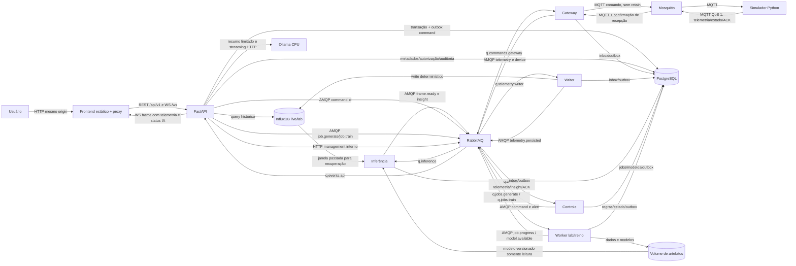
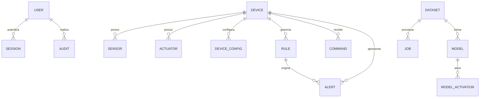

# Etapa 3 — Arquitetura-alvo AIoT

Base documental: `d3d9230`; código inventariado: `346f7de`. Branch: `docs/plano-etapa-3-arquitetura`. Complementa [inventário](./01-inventario.md) e [lacunas](./02-lacunas.md). Documento de planejamento: nenhum serviço, contrato ou comando abaixo foi implementado por esta entrega.

## 1. Decisões e fronteiras

| Decisão proposta | Motivo |
|---|---|
| Preservar Vue 3, Chart.js, FastAPI e os dois bancos | [V] Já declarados na aplicação; referências no inventário; trocar não resolve lacuna obrigatória |
| Simulador Python de split convencional | Mantém energia/desperdício e acrescenta degradação do compressor; ESP32/Wokwi preservado como legado |
| Uma imagem Python, comandos de processo por responsabilidade | Compartilha pacote e dependências; isolamento de falhas sem duplicar projetos |
| Mosquitto na borda e RabbitMQ no interior | Exigência acadêmica; nenhuma UI ou simulador acessa AMQP diretamente |
| PostgreSQL também para inbox/outbox e tentativas | Fecha lacunas de confirmação sem acrescentar Redis, Celery ou scheduler externo |
| Um worker para geração/treino, uma inferência | Controla consumo de RAM/CPU; não há um serviço por modelo |
| Influx → inferência → frame → API → WS | Faz a IA participar da entrega live; modelo indisponível produz status explícito e telemetria, sem previsão inventada |

Tudo que não está marcado [V] é proposta arquitetural. [I] A máquina com 15,7 GiB RAM e i5-12450H, verificada no inventário, pede limites conservadores. [N] Os budgets abaixo ainda não foram medidos.

## 2. Serviços e os três fluxos



O diagrama mostra ligações lógicas: setas AMQP são feitas pelo publicador de outbox no processo responsável, não por um daemon extra. Fluxos:

1. **IoT → Web:** amostra persistida localmente no simulador → MQTT → gateway → RabbitMQ → writer/Influx → RabbitMQ → inferência/frame → RabbitMQ → API/WS → dashboard/3D. Histórico REST consulta Influx; não alimenta a animação live.
2. **Web → IoT:** autenticação e comando idempotente → transação PostgreSQL/outbox → RabbitMQ → gateway → MQTT → intertravamentos do simulador → ACK/estado/leituras pelo mesmo caminho de volta. `pendente` não é estado físico observado.
3. **IA:** configuração do lab → job AMQP → dataset → treino → registro/promoção → evento de ativação → troca atômica na inferência → previsões e alertas AMQP → UI. Rótulos permanecem fora do live.

### 2.1 Inventário-alvo de serviços

Memória em MiB e CPU em núcleos são limites iniciais, não reservas garantidas. UID indicado é alvo a testar na imagem escolhida. Todos os serviços permanentes terão `/health` e `/ready` internos ou comando equivalente, além de heartbeat do loop; ausência de dependência não deve falhar liveness.

| Serviço | Responsabilidade/tecnologia | Portas publicadas / internas | Dependências de readiness | Healthcheck | Usuário-alvo | RAM/CPU | Volume gravável |
|---|---|---|---|---|---|---|---|
| frontend | Vue compilado, Nginx estático/proxy | `127.0.0.1:8080` / 8080 | API para proxy; shell pode carregar com API offline | HTTP `/healthz` | UID 10001 | 96 / 0,5 | tmpfs cache/tmp |
| api | FastAPI REST, WS, SSE, consultas e administração | nenhuma / 8000 | migrações, PostgreSQL, RabbitMQ; endpoints indicam degradação Influx/LLM | HTTP `/health`, `/ready` | UID 10001 | 384 / 1 | tmpfs; artefatos RO |
| simulator | sensores, atuadores e desgaste Python/NumPy | nenhuma / sem HTTP público | Mosquitto; spool disponível | processo + heartbeat/idade de tick | UID 10001 | 128 / 0,5 | simulator_spool |
| gateway | MQTT↔AMQP, normalização e spool transacional | nenhuma / health 9000 | PG, ambos brokers e bootstrap | heartbeat + sessões autenticadas | UID 10001 | 192 / 0,5 | tmpfs |
| writer | telemetria→Influx e evento persistido | nenhuma / health 9000 | PG, RabbitMQ, Influx | heartbeat + roundtrip limitado | UID 10001 | 256 / 1 | tmpfs |
| control | termostato, intertravamentos lógicos, alertas | nenhuma / health 9000 | PG, RabbitMQ | heartbeat + consumidor conectado | UID 10001 | 192 / 0,5 | tmpfs |
| inference | janelas, dois regressores, frames e qualidade | nenhuma / health 9000 | PG, RabbitMQ, Influx; sem modelo é estado permitido | heartbeat; modelo/status separados | UID 10001 | 640 / 1 | modelos RO; tmpfs |
| jobs-worker | geração/treino e registro | nenhuma / health 9000 | PG, RabbitMQ; volume de artefatos | heartbeat independente do job | UID 10001 | 1536 / 2 | artifacts |
| mosquitto | broker MQTT com ACL | nenhuma / 1883 | arquivo de credenciais válido | pub/sub de sonda restrita | UID da imagem, sem root | 64 / 0,5 | mosquitto_data |
| rabbitmq | AMQP + management | nenhuma / 5672 e 15672 | dados/configuração | diagnostics + bootstrap concluído | UID rabbitmq da imagem | 512 / 1 | rabbitmq_data |
| postgres | relacional, auditoria, inbox/outbox | nenhuma / 5432 | volume inicializado | pg_isready; schema conferido pelos runtimes após bootstrap | UID postgres da imagem | 512 / 1 | postgres_data |
| influxdb | séries temporais | nenhuma / 8086 | volume/setup básico | ping; buckets/tokens conferidos após bootstrap | UID não-root testado na imagem | 1024 / 1 | influxdb_data |
| ollama | modelo local quantizado em CPU | nenhuma / 11434 | cache de modelo | `/api/tags`; warmup é condição separada | UID 10001 com HOME gravável | 4096 / 4 | ollama_models |
| bootstrap | migrações, permissões, topologia e seeds | nenhuma / execução única | bancos/brokers saudáveis | exit 0; marker de versão | UID 10001 | 192 / 1 | secrets RO, manifestos |
| ollama-init | verifica/puxa modelo fixado e aquece | nenhuma / execução única | Ollama acessível | exit 0 após hash/digest e warmup | UID 10001 | 128 / 0,5 | cache via API Ollama |

A soma dos limites permanentes é cerca de 9,5 GiB; não significa que todos cabem simultaneamente no pico. Meta de uso agregado <=8 GiB com controle de concorrência da seção 11. Docker/WSL2: proposta de limite 10 GiB e 8 CPUs, deixando margem ao Windows; não editar a configuração do usuário nesta etapa.

Justificativas de processos/ferramentas: se remover **gateway**, MQTT não alcança AMQP com a fronteira definida; **writer**, perde-se persistência/confirmacão; **control**, perde-se regra automática isolada de treino; **inference**, perde-se IA live sem bloquear API; **jobs-worker**, treino/geração bloqueiam atendimento; **bootstrap**, sobe-se com schema/permissões indefinidos; **ollama-init**, a apresentação pode iniciar sem modelo. Nginx é o próprio servidor do frontend/proxy, sem serviço extra. Não incluir Redis, Celery, pgAdmin permanente, Prometheus/Grafana, Kubernetes ou service mesh.

## 3. Monorepo e compatibilidade

| Antes [V] | Depois proposto | Estratégia |
|---|---|---|
| `esp32-simulador/` | mesmo diretório, marcado legado | Preservar firmware/diagram e referências do primeiro bimestre |
| `web-smart-fan-iot/backend/app/` | API modular: auth, devices, commands, metrics, messaging, jobs, assistant | Reaproveitar energia e validações; extrair ingestão acoplada |
| `packages/smartfan_common/` | pacote instalável com contracts/v1, contracts/v2, features e routing | Uma fonte Python; schema/TS gerados, nunca copiados manualmente |
| Sem workers operacionais | `services/{simulator,gateway,writer,control,inference,jobs}/` | Entrypoints pequenos na mesma imagem Python |
| Compose em aplicação Web | mesmo entrypoint Compose, context de build na raiz | Acesso ao pacote comum sem duplicá-lo dentro do backend |
| Frontend dashboard único | `src/{pages,router,stores,scene,components,lib}/` | Vue Router e store reativo Vue; não exigir Pinia inicialmente |
| Ferramentas existentes | `tools/{bootstrap,smoke,backup,restore}/` | PowerShell para host Windows e comandos Python portáveis |
| Infra mínima | `infra/{rabbitmq,mosquitto,nginx}/`, `secrets/` ignorado | Configuração sem valores de credenciais versionados |

```text
smart-fan-iot/
├── docs/{plano,adr}/
├── esp32-simulador/                 # legado preservado
├── packages/smartfan_common/
│   └── src/smartfan_common/{contracts,features,routing}/
├── services/{simulator,gateway,writer,control,inference,jobs}/
├── infra/{rabbitmq,mosquitto,nginx}/
├── tools/{bootstrap,smoke,backup,restore}/
└── web-smart-fan-iot/
    ├── docker-compose.yml
    ├── backend/app/                 # API FastAPI
    └── frontend/src/{pages,router,stores,scene,components,lib}/
```

[V] O M00 atual usa `type`, `device_id`, `data`, `metadata.correlation_id`, schema `1.0` e `rul_operating_hours` ([contracts.py:66](../../packages/smartfan_common/src/smartfan_common/contracts.py#L66), [contracts.py:258](../../packages/smartfan_common/src/smartfan_common/contracts.py#L258)). **Decisão proposta:** contrato-alvo `2.0`, com os nomes pedidos no escopo e RUL em horas simuladas de calendário. Preservar v1 e fixtures; upgrade conjunto dos consumidores antes de habilitar produtores v2. V1 não vira v2 por alias, principalmente RUL: conversão entre horas de operação e calendário depende de perfil de uso e não será automática. Rotas legadas ficam apenas para histórico do ventilador, sem publicar controle HVAC.

O pacote é instalado por wheel, usado no treino e inferência; frontend consome JSON Schema e tipos gerados por versão, com checagem de divergência no CI. Todo evento valida estrutura, regras semânticas, produtor autenticado e rota antes de produzir efeito.

## 4. Contrato único de mensagem

### 4.1 Envelope JSON Schema 2020-12 proposto

O schema abaixo é o envelope fechado comum. Cada `tipo` seleciona também um schema de `conteudo` fechado na tabela seguinte; ambos serão gerados de Pydantic no pacote, formando o schema de união completo. O envelope isolado não valida o domínio e não basta para aceitar mensagem. Bytes máximos são limite de transporte, não `maxLength` de JSON Schema. Nenhum `.json` é criado nesta etapa.

```json
{
  "$schema": "https://json-schema.org/draft/2020-12/schema",
  "$id": "urn:smartfan:message:2.0",
  "type": "object",
  "additionalProperties": false,
  "required": ["id", "schema_version", "timestamp", "tipo", "dispositivo", "correlation_id", "conteudo", "metadata"],
  "properties": {
    "id": {"type": "string", "format": "uuid"},
    "schema_version": {"const": "2.0"},
    "timestamp": {"type": "string", "format": "date-time", "pattern": "Z$"},
    "tipo": {"enum": ["telemetry.sampled", "telemetry.persisted", "frame.ready", "insight.predicted", "command.requested", "command.applied", "command.rejected", "command.expired", "device.state", "device.availability", "transport.received", "alert.raised", "alert.cleared", "job.generate", "job.train", "job.progress", "model.available", "model.activated", "message.quarantined"]},
    "dispositivo": {"type": ["string", "null"], "pattern": "^[A-Za-z0-9_-]{1,64}$"},
    "correlation_id": {"type": ["string", "null"], "format": "uuid"},
    "metadata": {
      "type": "object", "additionalProperties": false,
      "required": ["producer", "causation_id"],
      "properties": {
        "producer": {"enum": ["simulator", "gateway", "writer", "control", "inference", "api", "jobs-worker"]},
        "causation_id": {"type": ["string", "null"], "format": "uuid"},
        "boot_id": {"type": "string", "format": "uuid"},
        "sequence": {"type": "integer", "minimum": 0, "maximum": 9007199254740991},
        "zone": {"type": "string", "pattern": "^[A-Za-z0-9_-]{1,64}$"},
        "equipment_type": {"const": "ac_split_onoff"},
        "observed_at": {"type": "string", "format": "date-time", "pattern": "Z$"},
        "clock_scale": {"const": 1}
      }
    },
    "conteudo": {"type": "object"}
  }
}
```

Regras complementares normativas: strings UTC devem representar datas reais; números finitos e validação sem coerção; metadata de amostra/frame exige boot, sequência, zona e tipo de equipamento; jobs/modelos/quarentena de transporte usam dispositivo nulo quando não aplicável; eventos de comando/estado exigem dispositivo cadastrado. `producer` é conferido contra a identidade autenticada e não é prova de autenticidade por si só. Labels de treino e campos extras são recusados em toda mensagem live.

### 4.2 Schemas de conteúdo e exemplos

Todos os objetos abaixo são fechados; campos listados são obrigatórios salvo `?`. UUIDs e datas seguem o envelope; nomes de sensores e unidades permanecem em inglês no conteúdo para reaproveitar o vocabulário M00, sem aliases ocultos.

| Tipo | Conteúdo normativo |
|---|---|
| telemetry.sampled / persisted | `readings`: cinco sensores do M00 + `power_w`, cada um float finito ou null; `actuators`: `compressor_on`, `condenser_fan_on` booleanos; `quality.missing_fields`: lista única exatamente dos cinco sensores nulos; persisted acrescenta `source_event_id` |
| frame.ready | `source_event_id`, `telemetry` (conteúdo persistido), `insight` (status, versão de modelo nullable, versão de features, `health_score` 0..100/null e `rul_calendar_hours` >=0/null); status enum valid/warming_up/insufficient_data/inactive/stale/model_unavailable/out_of_domain |
| insight.predicted | Mesmo objeto `insight` do frame, acrescido de `source_event_id`; evento separado para controle, sem reproduzir telemetria no conteúdo |
| command.requested | `command_id` igual a id do envelope, `target_boot_id`, `revision` inteiro >=0, `desired` com dois booleanos, `mode` manual/auto, `expires_at` UTC e `reason_code` identificador; compressor ON e ventilador OFF é inválido |
| command.applied/rejected/expired | `command_id`, `revision`, `observed` com os dois atuadores, `reason_code`; aplicado só após simular aplicação; rejeitado/expirado não alteram estado |
| device.state | `actuators`, `mode` manual/auto, `manual_cooling_block` booleano, `reason_code` |
| device.availability | `status` online/offline, `reason_code`; metadata boot e instante observado no gateway |
| transport.received | `source_event_id`, `status` igual a `durably_received`; só gateway→simulador; não confirma persistência Influx nem efeito físico |
| alert.raised/cleared | `alert_id`, `rule_id`, `severity` info/warning/critical, `source_event_id`, `reason_code`; transição persistida no PostgreSQL |
| job.generate/train | `job_id`, `dataset_id`, `config_version` inteiro positivo; configuração imutável completa no PG; mensagem não carrega milhão de dados |
| job.progress | `job_id`, `kind` generate/train, `status` queued/running/completed/failed/cancelled, `processed`, `total` inteiros >=0, processed<=total, `reason_code?` |
| model.available/activated | `model_version`, `feature_version`, `dataset_id`, `sha256` de 64 hexadecimais; API/inferência consulta registro autorizado, sem caminho arbitrário |
| message.quarantined | `failure_id`, `owner`, `reason_code`, `original_sha256`, `original_bytes_b64` string/null, `original_ref` UUID/null, `original_route`, `attempts`; exatamente um entre bytes e referência protegido no PG; nunca renderizado como HTML |

Exemplo concreto de comando: timestamp de criação real, prazo de 15 s, sem segredo:

```json
{
  "id": "11111111-1111-4111-8111-111111111111",
  "schema_version": "2.0",
  "timestamp": "2026-11-08T22:00:00Z",
  "tipo": "command.requested",
  "dispositivo": "ac_01",
  "correlation_id": "22222222-2222-4222-8222-222222222222",
  "metadata": {"producer": "api", "causation_id": null, "zone": "quarto", "equipment_type": "ac_split_onoff"},
  "conteudo": {
    "command_id": "11111111-1111-4111-8111-111111111111",
    "target_boot_id": "33333333-3333-4333-8333-333333333333",
    "revision": 12,
    "desired": {"compressor_on": false, "condenser_fan_on": true},
    "mode": "manual",
    "expires_at": "2026-11-08T22:00:15Z",
    "reason_code": "manual_fan_on"
  }
}
```

**Limites:** MQTT e eventos normais <=16 KiB UTF-8; mensagens de quarentena <=32 KiB para preservar base64 de um payload permitido. Gateway rejeita payload maior antes de aceitar; broker também limita. Payload acima de 16 KiB é preservado no PG até teto de 256 KiB, com referência pequena na DLQ em vez de base64 inline. Acima de 256 KiB o registro indica truncamento e hash dos bytes efetivamente recebidos, nunca alegando preservação completa. Nenhum job inclui dataset inline. Batch de gravação pode reunir mensagens, mas mantém IDs individuais. O original aceito e dentro do limite permanece preservado integralmente.

**Identidade/ordem:** UUID único de evento, mesmo ID/bytes em retry; ID repetido com hash diferente é conflito/quarentena. Derivados têm novo ID determinístico por evento-fonte/tipo/versão. Sequência crescente por equipamento e boot; não existe ordem global entre filas. Um consumidor ativo por fila; comandos por dispositivo usam revisão transacional monotônica. Dados fora de ordem podem ir ao histórico, mas não substituem observação live mais nova nem retroagem regra/alerta. Comparar `(boot autorizado, sequence, timestamp)`; boot novo exige nova presença autenticada.

## 5. Mensageria e semântica de entrega

### 5.1 Topologia RabbitMQ

Vhost exclusivo `/smartfan`. Exchanges duráveis: `smartfan.events` topic, `smartfan.jobs` topic e `smartfan.dlx` topic. Filas duráveis quorum em nó único; persistência local não é alta disponibilidade nem replica fora do computador. Mensagens persistentes, publicação com confirms e mandatory/returns. Validação impede publicar para rota sem binding; falha de roteamento fica pendente na outbox, não é sucesso.

| Fila | Exchange/binding | Consumidor | Prefetch | TTL/limite |
|---|---|---|---|---|
| q.telemetry.writer | events `telemetry.*.hvac.*` | writer | 32 | Sem expiração; quota/backpressure |
| q.inference | events `persisted.*.hvac.*`, `model.available` | inference | 32 | Sem expiração; dado antigo não anima UI |
| q.control | events `telemetry.*.hvac.*`, `insight.*`, `ack.*` | control | 16 | Sem expiração; regra rejeita telemetria antiga |
| q.events.api | events `frame.*`, `alert.*`, `ack.*`, `device.*`, `job.progress`, `model.activated` | api | 32 | Sem expiração; filtrar frescor antes de WS |
| q.commands.gateway | events `command.*` | gateway | 1 | Sem TTL broker; expires_at é verificado ponta a ponta |
| q.jobs.generate | jobs `job.generate` | jobs-worker | 1 | Sem expiração; status/auditoria persistidos |
| q.jobs.train | jobs `job.train` | jobs-worker | 1 | Sem expiração; só um job pesado no conjunto |
| q.dlq | dlx `#` | sem consumidor destrutivo automático | não aplicável | Sem expiração; quota com reject-publish |

Exemplos: `telemetry.quarto.hvac.ac_01`, `persisted.quarto.hvac.ac_01`, `command.ac_01`, `ack.ac_01`, `frame.ac_01`, `insight.ac_01`, `alert.critical`, `device.ac_01`, `job.generate`. Prefixos diferentes evitam que derivado volte a alimentar writer. São uma **migração v2** da [topologia M00:19](../../packages/smartfan_common/src/smartfan_common/topology.py#L19), não a topologia já instalada.

**Retry:** inbox PostgreSQL registra payload, hash, estado, tentativa, `due_at`, lease e erro. Falha transitória adia em 1, 5 e 30 s com jitter <=20%; após cinco tentativas vira falha permanente preservada e publicada na DLQ. Indisponibilidade de dependência reconhecida abre circuito e pausa o consumidor, sem esgotar tentativas por segundo. Poll de tarefas de retry no próprio processo a cada <=1 s; não criar fila temporária por erro nem requeue infinito. Não se usa delayed-message plugin. Um novo evento só é ACKado quando sucesso ou retomada/falha está duravelmente registrada; se PG indisponível, manter não confirmado e suspender ingestão.

**DLQ segura:** falha permanente grava original e motivo em PG + outbox para dlx; ACK original após commit dessa decisão. Publicador confirma chegada à DLQ. Política nativa DLX para poison/limite de entregas é rede de proteção, com dead-letter at-least-once de quorum e reject-publish onde suportado na versão fixada. Se não suportar, bootstrap deve falhar; não assumir garantia de DLX clássico. Teto inicial 256 MiB por fila de trabalho e DLQ, com alarmes em 70/90% e rejeição de publicação, nunca drop-head. Esses tetos precisam de ensaio de carga.

**Mensageria:** backend consulta management a cada 2 s, com timeout 2 s/cache; UI recebe por WS contagens ready/unacked, publish/deliver rates, consumidores e DLQ. Últimas mensagens são amostras redigidas do journal/inbox, com ID e correlação, não `get` destrutivo nas filas. DLQ mostra metadados do registro de falha e contagem real. Replay exige administrador, justificativa, nova validade/boot quando comando e nova auditoria; não reproduzir comando vencido.

Confirms do publicador e ACKs do consumidor confirmam etapas diferentes; nenhum confirma o atuador. A recuperação pode duplicar mensagens, exigindo idempotência. Referências: [RabbitMQ confirms](https://www.rabbitmq.com/docs/confirms) e [reliability](https://www.rabbitmq.com/docs/reliability). A política at-least-once da DLX deve ser testada na versão pinada: [dead-letter exchanges](https://www.rabbitmq.com/docs/dlx).

### 5.2 Usuários e permissões AMQP

Bootstrap cria usuários únicos por serviço e remove guest. `configure` é regex sem correspondência para usuários runtime; bootstrap declara exchanges, queues, bindings e políticas. Read é ancorado nas filas próprias; write no exchange não basta: aplicar também topic permissions para limitar routing keys. A tabela descreve allowlists, não credenciais.

| Identidade | configure | write em exchanges / tópicos permitidos | read |
|---|---|---|---|
| gateway | nenhum | events: telemetry, device, ack; dlx: falhas próprias | q.commands.gateway |
| writer | nenhum | events: persisted; dlx: falhas próprias | q.telemetry.writer |
| inference | nenhum | events: frame, insight, model.activated; dlx própria | q.inference |
| control | nenhum | events: command, alert; dlx própria | q.control |
| api | nenhum | events: command; jobs: job.generate/train; dlx própria | q.events.api |
| jobs-worker | nenhum | events: job.progress/model.available; dlx própria | q.jobs.generate e q.jobs.train |
| api-monitor | nenhum | nenhum | visibilidade management do vhost; sem consumo via aplicação |
| bootstrap | topologia do vhost | bindings/declarações necessárias | somente instalação; segredo não montado nos runtimes |

Regexes devem ser `^...$`, escapar pontos e recusar default exchange; clientes runtime usam declaração passiva em vez de tentar criar fila. O segredo api-monitor fica só no backend e deve ter escopo/tag management mínimo compatível com estatísticas; validação negativa prova que não altera usuários/políticas. Limitar permissões de recurso e de tópico separadamente: [RabbitMQ access control](https://www.rabbitmq.com/docs/access-control).

### 5.3 MQTT e garantia por fronteira

| Tópico v2 | Cliente autorizado a escrever | Leitura | QoS/retain |
|---|---|---|---|
| `devices/{id}/telemetry` | simulator_{id} | gateway | 1 / não |
| `devices/{id}/state` | simulator_{id} | gateway | 1 / sim |
| `devices/{id}/acks` | simulator_{id} | gateway | 1 / não |
| `devices/{id}/availability` | simulator_{id}, LWT | gateway | 1 / sim |
| `devices/{id}/commands` | gateway | simulator_{id} | 1 / não |
| `devices/{id}/receipts` | gateway | simulator_{id} | 1 / não |

ACL é lista exata por usuário/dispositivo; não dar `devices/#` ao simulador. Gateway tem wildcard só para categorias previstas. Sonda de health usa namespace isolado e usuário próprio. `allow_anonymous false`; senhas hash no broker. Client IDs estáveis, sessões persistentes e reconexão 1..30 s com jitter. LWT retained offline contém boot/configuração necessária, mas gateway atribui `observed_at` ao receber; timestamp de configuração do will não é instante real de queda. Retained state não renova frescor de telemetria. Sintaxe de ACL/persistência: [Mosquitto configuration](https://www.mosquitto.org/man/mosquitto-conf-5.html).

| Fronteira | Confirmação e recuperação proposta |
|---|---|
| Simulador→gateway | SQLite local por simulador com amostra/fsync antes de publicar; manter até receipt de aplicação. Gateway grava inbox/outbox PG e só então publica receipt; PUBACK MQTT sozinho não elimina spool |
| Gateway→RabbitMQ | Outbox transacional; confirma broker + ausência de return antes de marcar entregue; mesmo ID no retry |
| RabbitMQ→writer→Influx | Inbox com payload e chave de ponto determinística; grava Influx, depois PG com evento persisted/outbox. Queda entre bancos regrava o mesmo ponto; não recria timestamp |
| Inferência/controle→RabbitMQ | Resultado/decisão e outbox no mesmo commit PG; duplicatas retornam decisão registrada; janela/ordem recuperadas antes de processar novo evento |
| Comando→simulador | Gateway guarda pendência até ACK de aplicação; republicação mantém ID/revisão. Simulador registra comando aplicado e resultado em SQLite junto do estado simulado; repetição retorna mesmo ACK |
| API→navegador | WS não é fila durável; reconexão busca snapshot autorizado, histórico por REST e recebe novo stream. Não prometer entrega de todo frame ao browser |

At-least-once cobre eventos aceitos enquanto volumes estiverem íntegros e a indisponibilidade couber no armazenamento. Spool cheio pausa simulação/coleta e mostra falha; não descarta silenciosamente nem promete medir enquanto o processo estiver desligado. Perda de disco, `down -v`, exclusão manual e falha física do computador exigem backup; não são cobertas por um broker único.

## 6. PostgreSQL, InfluxDB e modelo inicial

### 6.1 DER resumido e migrações



| Tabelas | Campos/chaves essenciais |
|---|---|
| users/sessions | UUID, username único, password_hash, role enum, enabled, auth_version; sessão jti hash, expiração/revogação |
| devices/sensors/actuators | device_id único; equipment_type/zone, enabled; sensor_id único e tipo/unidade/faixa normal; actuator_id/capacidades/intertravamentos |
| device_configs/rules | configuração versionada, setpoint, histerese, mínimos de ciclo, faixa saudável, prioridades; regra ativa por versão |
| commands | UUID, chave idempotência por usuário, request_hash, revisão única por dispositivo, desejado/observado, boot esperado, expires_at, status e motivo |
| alerts/audit | fonte, regra, severidade, estado e transições; ator, ação, objeto, correlação, resultado e UTC; sem senha/token no JSON |
| jobs/datasets/models/activations | configuração imutável, seed, progresso, hash, versão de features, métricas, splits, decisão de promoção, referência segura ao artefato |
| inbox/outbox/retries/failures | consumidor+id únicos, hash, payload, due_at, lease; outbox id/rota únicos; tentativas e bytes originais com limites |
| ws_tickets/login_limits/resource_leases | ticket hash/TTL/usuário/origin/consumido; contadores de login; exclusão de job pesado/chat |

Alembic é a única autoridade de schema novo; bootstrap executa `upgrade head` antes dos runtimes. Preservar tabela/IDs legados por migração incremental e backup prévio; `create_all` não atualiza schema existente. Índices: device_id único; commands(device_id, revision), (status,expires_at); alerts(device_id,status,created_at); audit(created_at,id), (actor_id,created_at); inbox(consumer,event_id) único; outbox/retries(due_at,status) parcial; jobs(status,created_at). Não indexar todo JSONB. Papéis PG por serviço, sem DDL runtime; grants por tabela/schema, não superuser compartilhado.

### 6.2 Séries temporais

Adotar os measurements/buckets da [etapa 2, seção 7](./02-lacunas.md#7-impacto-no-influxdb-e-separação-de-dados): live/hvac_telemetry e hvac_insight 30 dias, lab/hvac_lab_sample 7 dias; amostra <=100 mil por dataset e <=300 mil no bucket lab. Dataset completo no volume de artefatos, não em mensagens. Histórico legado preservado. Tokens: writer escreve live; API lê live/lab; jobs escreve só lab; inferência lê live; token de setup fica só no bootstrap.

Ponto é `(measurement, tags, timestamp)`: PG reserva essa chave única por equipamento/amostra e associa event_id/hash antes da escrita; colisão com outro ID de amostra é falha permanente preservada, não merge silencioso de fields. Retries usam mesmo payload/timestamp; faltantes omitem fields, qualidade registra nulos. Registro idempotente fica por pelo menos 31 dias; comandos e IDs no simulador por 7 dias, com rejeição adicional de boot/revisão/expiração para replays mais antigos. Expiração de dedupe é documentada, não garantia de dedupe infinita.

event_id, boot_id, model_version e dataset_id são fields, nunca tags de crescimento ilimitado. Inicialmente até 1000 equipamentos/zonas controladas; medir cardinalidade e disco. Consultas UI limitam 1000 pontos, paginação de histórico bruto e deadline 3 s; integração energética não usa downsample para contabilidade. Não misturar amostras lab e live para prognóstico. Referência: [InfluxDB v2 schema design](https://docs.influxdata.com/influxdb/v2/write-data/best-practices/schema-design/).

Retenção transacional: após sucesso, payloads completos de inbox/outbox ficam no máximo 24 h; IDs/hashes/chaves de dedupe permanecem 31 dias, sem reter cópia integral de toda a telemetria nesse período. Pendências e falhas não são apagadas automaticamente. Journal de prévias mantém no máximo 200 registros por serviço. Spool do simulador tem teto inicial de 512 MiB e pendências PG de 1 GiB por proprietário, com alerta em 70/90% e pausa de aceitação ao atingir teto; limites finais dependem de teste de disco e volume por mensagem. Limpeza só remove estados terminais, nunca a única cópia de evento ainda não entregue.

## 7. API, autenticação e segredos

### 7.1 Contratos HTTP

OpenAPI em `/api/v1/openapi.json`; docs em `/api/v1/docs`. FastAPI/Pydantic valida corpo, query, resposta, tamanho e contexto. Paginação cursor por `(created_at,id)`, limit default 50/max 100. REST de comandos retorna 202 com Location para status; não marca dispositivo ligado ao aceitar pedido.

| Área | Rotas propostas |
|---|---|
| Auth | POST `/api/v1/auth/login`, POST `/logout`, POST `/ws-ticket`; GET `/me` |
| Dispositivos | GET/POST `/devices`; GET/PATCH `/devices/{id}`; desativação lógica e configuração versionada |
| Controle | POST `/devices/{id}/commands`; GET `/commands/{id}`; PATCH `/devices/{id}/rules/{rule_id}` |
| Leitura | GET `/devices/{id}/metrics`, `/devices/{id}/insights`, `/alerts`; GET `/snapshot` autorizado |
| Mensageria | GET `/messaging/overview`, `/messaging/failures`; POST `/messaging/failures/{id}/replay` |
| Lab/ML | POST/GET `/datasets`, `/training-jobs`, `/jobs/{id}`; POST `/jobs/{id}/cancel`; GET `/models` e `/models/{version}/metrics` |
| Assistente | POST `/assistant/responses` com stream SSE; cancelamento pelo fechamento do request |
| Admin | GET `/audit`, `/admin/links`; operações restritas de usuário/configuração |

Erros `application/problem+json` conforme RFC 7807, com type/title/status/detail/instance e extensões code/correlation_id/errors; nunca stacktrace ou credencial. Exemplo: `{"type":"urn:smartfan:problem:device-offline","title":"Dispositivo sem dados recentes","status":409,"detail":"Aguarde uma leitura atual antes de comandar.","instance":"/api/v1/devices/ac_01/commands","code":"device_offline","correlation_id":"22222222-2222-4222-8222-222222222222"}`. HTTP 401 sem autenticação, 403 sem permissão, 409 conflito/intertravamento, 422 entrada inválida, 429 limite, 503 dependência.

`Idempotency-Key` UUID obrigatório em comandos e jobs. PG vincula usuário/rota/chave/hash por 24 h; mesma chave/corpo retorna mesmo resultado, corpo diferente 409. Após esse prazo, UI gera intenção nova, com nova validade. Transação reúne comando, revisão, auditoria e outbox; publicador não fica esperando MQTT no request. Máquina de estados pública: `pendente → confirmado/falhou`; campos internos detalham queued/published/applied/rejected/expired/timeout. Timeout significa confirmação ausente, não prova de que não executou; reconsulta estado antes de nova intenção. Boot mudou ou dado stale: recusar início de refrigeração.

### 7.2 Auth e matriz de papéis

JWT HS256 com segredo aleatório >=256 bits, expiração 30 min, claims sub/role/jti/auth_version/iss/aud/iat/exp, algoritmo allowlist e tolerância de relógio <=30 s. Sem refresh inicial: novo login após expiração. Access token só em memória JS, enviado em Authorization Bearer; não localStorage nem querystring. Logout revoga sessão; backend consulta sessão/versão em operações e encerra streams expirados/revogados em <=5 s. Papel no JWT não substitui checagem de usuário ativo e recurso.

| Operação | Visualizador | Operador | Administrador |
|---|---|---|---|
| Dashboard, histórico, Insights e 3D | ler | ler | ler |
| Assistente sobre dados autorizados | usar | usar | usar |
| Comandar atuador/simulador, cenário de demonstração | negar | permitir com auditoria | permitir |
| Cadastro/configuração de dispositivo e regras | negar | ler | alterar |
| Gerar dados, treinar, promover modelo | negar | negar | permitir |
| Mensageria, DLQ, auditoria e links administrativos | negar | negar | permitir |
| Usuários/roles/segredos operacionais | negar | negar | administrar por fluxo restrito; nenhum segredo retornado |

Ticket WS: POST autenticado retorna valor opaco aleatório >=128 bits, TTL 30 s, armazenado somente hash e usuário/origin/escopo; navegador envia ticket na primeira mensagem após abrir `/ws`. Socket sem autenticar fecha em 5 s; sem subscriptions antes de consumir ticket atomicamente. Uma reutilização falha; nunca JWT/ticket em URL. Limitar conexões pendentes por IP e 3 sockets por usuário; reautenticar com novo ticket após reconexão. Autorizar filtro de dispositivos no servidor, não só frontend.

Senhas bcrypt com custo inicial 12, ajustável para verificação p95 <=300 ms na máquina; recusar >72 bytes UTF-8 para evitar truncamento silencioso. Login: limite 5 falhas/15 min por identidade e 30/IP/15 min, atraso progressivo e mensagem genérica, sem bloqueio permanente induzido por terceiro. Configurar proxy confiável e não confiar em X-Forwarded-For arbitrário. Dados e hash nunca em logs.

Bootstrap gera usuários demonstrativos de cada papel com senhas aleatórias, sem admin/admin. Nomes no README, senhas somente em arquivo local ignorado e ACL do host; nunca no chat/commit. Script gera secrets sem sobrescrever existentes, valida placeholders, configura permissões e documenta rotação: emitir novo → atualizar consumidor → confirmar → revogar antigo. JWT muda com encerramento de sessões; credenciais MQTT/AMQP rotacionadas por serviço; imagens e logs não recebem valores por build-arg.

Proxy same-origin, CORS fechado para a origem configurada; Origin também em WS. Frontend publicado apenas em loopback para apresentação. Acesso LAN exige configuração explícita de HTTPS/WSS e origem; não expor credenciais em HTTP remoto. CSP restrita, frame-ancestors none, nosniff; Markdown com HTML desabilitado, links allowlist http/https e sem execução de scripts.

### 7.3 Modelo de ameaças STRIDE curto

| Fronteira | Ameaças | Controle verificável | ASVS 5 pertinente |
|---|---|---|---|
| Navegador↔API | S/E: token roubado ou papel forjado; T: comando adulterado | JWT validado + sessão, autorização por recurso/campo, idempotência e intertravamentos; teste negativo 401/403 | V6 Authentication; V7 Session Management; V8 Authorization |
| Navegador↔API/WS | D: login/socket/chat em massa; I: vazamento por URL/log | Rate limits, teto de corpo/sockets, ticket de uso único e redaction | V2 Validation and Business Logic; V3 Web Frontend Security |
| API↔brokers | S/E/T: consumidor publica comando em rota alheia | Conta por serviço, vhost/topic ACL, validação de produtor/schema; teste de publish/consume proibido | V8 Authorization; V2 Validation |
| Simulador↔MQTT | S/T/R: spoof de outro equipamento, replay, negar autoria | ACL por ID, boot/revisão/expiração, receipt/ACK e auditoria correlacionada | V6 Authentication; V8 Authorization; V2 Validation |
| Assistente↔LLM | T/E: prompt injection; I: pedir segredos; D: contexto enorme | Resumo allowlist, dados tratados como não confiáveis, sem tools/SQL/comandos, tokens/concorrência limitados | V1 Encoding and Sanitization; V2 Validation; V8 Authorization |
| LLM↔UI | T/I: HTML, URL/script e resposta inventada | Markdown sem HTML, escape, URL segura; fontes do resumo e carimbo temporal; não usar texto para atuador | V1 Encoding; V3 Frontend Security |
| Persistência/volumes | R/I/D: apagar auditoria, roubar dumps, encher disco | Grants sem delete de auditoria runtime, backups protegidos, quotas e backpressure | V8 Authorization e controles de dados a detalhar no aceite |

O mapa usa capítulos da versão 5, não numeração antiga: [V1](https://raw.githubusercontent.com/OWASP/ASVS/v5.0.0/5.0/en/0x10-V1-Encoding-and-Sanitization.md), [V2](https://raw.githubusercontent.com/OWASP/ASVS/v5.0.0/5.0/en/0x11-V2-Validation-and-Business-Logic.md), [V3](https://raw.githubusercontent.com/OWASP/ASVS/v5.0.0/5.0/en/0x12-V3-Web-Frontend-Security.md), [V6](https://raw.githubusercontent.com/OWASP/ASVS/v5.0.0/5.0/en/0x15-V6-Authentication.md), [V7](https://raw.githubusercontent.com/OWASP/ASVS/v5.0.0/5.0/en/0x16-V7-Session-Management.md), [V8](https://raw.githubusercontent.com/OWASP/ASVS/v5.0.0/5.0/en/0x17-V8-Authorization.md). É mapeamento para testes, não declaração de conformidade ASVS completa.

## 8. Observabilidade mínima

Logs JSON: UTC, level, service, event_id, correlation_id, device_id quando aplicável, duration_ms, outcome e reason_code. Não registrar JWT, headers de auth, segredo, prompt completo ou payload sem redaction. Rotação Docker: 10 MiB x3 por serviço inicialmente. Auditoria registra login/logout, falhas relevantes, comando, mudança de regra, job, promoção, replay e pergunta com resumo minimizado; pergunta até 500 caracteres ou hash quando contiver dado sensível.

`/health` responde processo/event-loop ativo; `/ready` detalha PG, AMQP/MQTT/Influx quando necessário e schema; readiness do modelo é atributo separado. API retorna 503 nos endpoints dependentes em vez de declarar toda a aplicação morta por LLM frio. Healthcheck não deve criar dados de negócio. Latência, erros, backlog, reentregas, dedupe, idade de dados, modelos/versões, jobs e TTFT são contadores/histogramas internos expostos no backend administrativo. Management RabbitMQ e logs bastam para o mínimo; Prometheus/Grafana só se a falta de histórico de métricas impedir comprovar as metas.

## 9. Frontend, tempo real e cena 3D

Páginas: Dashboard, Dispositivos, Cena 3D, Mensageria, Laboratório, Treinamento, Insights, Assistente e Administração (Links/Auditoria). Vue Router com lazy imports; guards por papel para UX, autorização real na API. Store reativo Vue indexado por device_id/sensor_id/actuator_id, com snapshot inicial autorizado e mapas de versões, boots e sequência. Evitar framework 3D adicional; Three.js direto.

WS backoff 1,2,4,8..30 s com jitter; heartbeat aplicação a cada 15 s e timeout 45 s. Telemetria live a cada 2 s; após 6 s sem amostra fresca estado `sem dados` e animação congela. Presença MQTT, socket conectado e frescor são estados separados. API descarta backlog para animação e notifica atraso; histórico continua disponível por REST. Frame inclui instante amostrado e observado no gateway; rejeitar amostra futura/relógio fora de tolerância, sem ajustar silenciosamente dado do dispositivo.

**Relógios:** todo fluxo live usa UTC real e clock_scale=1; valores diferentes são recusados pelo contrato. Apenas artefatos do laboratório percorrem tempo sintético. Para demonstrar falha em poucos minutos, pode-se acelerar a progressão da degradação, nunca timestamp, cadência, janela de features, expiry ou intervalo mínimo de partida. Identificar o cenário e avaliar seu efeito no modelo; se fora do domínio, informar abstenção em vez de previsão enganosa. Frescor usa timestamp real, carimbo confiável observed_at registrado no journal do gateway e progresso da sequência; writer propaga o carimbo em evento derivado conforme a etapa 4. Replay não vira fresh por receber novo horário de recepção. RUL mantém a unidade de calendário do cenário de treino, sem multiplicação pelo fator didático de degradação.

Cena procedural: cômodo, evaporadora, condensadora, compressor, cinco sensores e dois atuadores, cada um vinculado ao ID do cadastro. Posições e geometria ficam só no frontend. Compressor treme segundo vibração recebida; ventilador gira só ligado e com dado fresco. Dois efeitos ambientais: temperatura interna muda mapa térmico do cômodo; temperatura externa muda mapa térmico externo; o fluxo de ar representa estado/efeito do atuador recebido, sem inventar medição de vazão.

Store atualiza buffer de dados por mensagem; `requestAnimationFrame` lê esse buffer e modifica transforms/uniforms de objetos existentes. Fase de animação usa delta limitado e cessa quando stale; não cria física autônoma que continue após parada do simulador. Cores normal/atenção/crítico/sem dados combinam faixa saudável configurada e alerta IA ativo. Clique/teclado abre painel com leitura, minigráfico, saúde/RUL/qualidade e botões autorizados; comandos só mudam visual após retorno observado. Cabos/tubos usam coordenadas dos pontos de conexão, sem pontas soltas.

Budget inicial: <=50 mil triângulos, <=100 draw calls, pixel ratio <=1,5, alvo >=30 FPS na máquina; instâncias para repetição, sem reconstrução por mensagem e descarte de geometria/material ao sair. Pausar trabalho gráfico em aba oculta; ao voltar, revalidar frescor antes de retomar. [Three.js rendering on demand](https://threejs.org/manual/pages/rendering-on-demand.html) fundamenta renderizar apenas quando há mudança/animação necessária.

Toda tela terá carregando/vazio/erro/offline/sem permissão; erro de modelo separado de falta de sensor. Contraste WCAG AA, foco visível, navegação por teclado, labels, aria-live moderado, tabela textual equivalente à cena e gráficos. Preferência de movimento reduzido evita tremor/rotação contínua, mantendo estado textual.

## 10. ML, datasets e modelos

Gerador NumPy em blocos de 50 mil vetores (teto configurável), >=1 milhão por dataset padrão, teto inicial 5 milhões, seed e substreams por equipamento. Período em dias e passo temporal determinam volume; UI mostra cálculo antes do job. Mínimo recomendado 30 equipamentos para split e diversidade, máximo 1000 do pacote. Sensores por tipo: cada canal físico recebe sensor_id e uma posição de medição cadastrada; perfil mínimo exige um sensor de cada tipo por equipamento. Sensores adicionais são gerados e armazenados como canais auxiliares no lab; modelo usa somente a seleção de cinco canais primários registrada no manifesto. Não mudar forma do vetor live para arrays sem novo schema.

Configuração contém dias, equipment_count, sensor_counts, failure_fraction, failure_modes, noise_std, missing_fraction, outlier_fraction, seed, sample_interval e records_cap. Saída de job só é completed após conferir contagem/hash, concluir manifesto e mover diretório temporário atomicamente no mesmo volume. Cancelamento é cooperativo entre blocos; parcial fica marcado e não é treinável. Artefatos completos usam NumPy/memmap, sem construir milhão de dicts; amostra Influx é separada do artefato de verdade.

[V] Features M00 atuais são causais e compartilhadas ([features.py:90](../../packages/smartfan_common/src/smartfan_common/features.py#L90)). Preservar implementação de referência; otimização NumPy só entra se equivalência numérica e de estados for testada. Janela inicial 60 s/30 s de span/80% de cobertura/lacuna 5 s; mudança gera feature_version nova. Duplicatas, mudança de boot, compressor desligado e warmup têm a mesma semântica em treino/live. Eventos atrasados não reescrevem o vetor que já produziu comando.

Dois alvos: health_true (0..100) e RUL em horas simuladas de calendário. Sem futuro, ID, dano latente, failure_at, seed ou modo de falha como features. Censurados não têm RUL exata: não inventar zero; excluí-los da perda de RUL, mantendo saúde e avaliação de falsos positivos, com proporção/viés reportados. Não prometer vida útil real sem dados/calibração reais.

**Modelos:** Ridge com scaler como candidato simples e HistGradientBoostingRegressor com limites de profundidade/iterações como candidato não linear; para cada alvo escolher um modelo, resultando em dois regressores ativos. Baseline DummyRegressor(mean) por alvo. Split 60/20/20 por equipamento, seed fixada; validar identidades disjuntas antes de ajustar scaler/imputação. Modelos avaliam MAE, RMSE, R², scatter previsto/real e permutation importance numa amostra da validação limitada e reproduzível. Teste fica reservado para aceite de candidato escolhido sem tuning sobre ele. [GroupShuffleSplit](https://scikit-learn.org/stable/modules/generated/sklearn.model_selection.GroupShuffleSplit.html) é referência para divisão por grupos.

Métricas indefinidas por alvo constante, ausência de falhas ou amostra insuficiente aparecem como indisponíveis com motivo; candidato não é promovido fabricando R² ou omitindo a lacuna. Verificar diversidade dos alvos por grupo antes do treino. Importância é calculada por alvo e sobre o modelo já ajustado, sem ajustar novamente no conjunto usado para explicação.

**Registro/promoção:** modelo tem versão, hash dataset, hashes dos artefatos, split IDs/hash, feature order/version, unidade RUL, config de janela, algoritmo/hiperparâmetros, métricas e model card curto com limitações/censura. Política inicial: ambos os alvos devem reduzir MAE >=5% contra baseline e não piorar RMSE; contra versão ativa no mesmo benchmark, MAE não pode piorar e pelo menos um alvo melhora >=2%, sem regressão >10% em modo de falha com amostra suficiente. Primeira versão dispensa comparação com ativa, não com baseline. Se o benchmark mudar, avaliação comparável é obrigatória; sem evidência, candidato fica disponível, não promovido.

Promoção aprovada usa transação PG com desired_version, activation_revision monotônica e outbox model.available. Candidato reprovado fica no registro, sem publicar pedido de ativação. Receber model.available sozinho não autoriza reload: inferência consulta aprovação/métricas no registro e exige versão/hash compatíveis e iguais à seleção desired vigente. Carrega para objeto novo e faz smoke prediction; imediatamente antes da troca, revalida versão e revisão sob bloqueio transacional compartilhado com o promotor. Evento atrasado, duplicado ou sem aprovação não substitui o modelo. Só após troca atômica entre amostras registra versão ativa e publica model.activated; API exibe a versão efetivamente em uso. Se PG estiver indisponível, não inicia troca; se cair após a troca, reconcilia active/outbox antes de confirmar ativação. Falha mantém modelo anterior quando possível e alerta, sem declarar desired como active. Em restart, reconcilia registro e artefato antes de servir previsão. Artefatos serializados só de worker confiável; não aceitar upload nem desserializar caminho de usuário. Reconstruir janela passada pelo Influx em reinício; enquanto não válida, abstém-se.

Controle persiste contadores de histerese por regra/dispositivo/versão: exemplo saúde<40 ou RUL<24 h por 3 previsões frescas ativa; saúde>45 e RUL>30 h por 10 limpa. Limites são didáticos configuráveis e ficam no registro de regra, não hardcoded como verdade física. Dados insuficientes/stale não limpam alerta. Modelo novo reinicia contadores candidatos, preservando alerta ativo até evidência suficiente de recuperação.

Drift mínimo: distribuição de features versus benchmark por bins/quantis em janelas de 1000 vetores válidos, taxa de out-of-range e faltantes; alerta se >20% fora de p1..p99 de treino por 3 janelas. Sem ground truth real, isso sinaliza mudança, não mede acurácia live. Não retreinar/promover automaticamente por drift.

## 11. Assistente local e orçamento compartilhado

Ollama CPU com modelo candidato `llama3.2:3b` quantizado Q4; registrar digest exato do modelo instalado e licença no manifesto. [N] RAM, TTFT e qualidade em português ainda precisam de benchmark. Se não couber nos alvos, alternativa prevista `llama3.2:1b` quantizado, com a redução registrada e avaliada; nunca fallback cloud. Sem Open WebUI, vetor database ou RAG framework no mínimo.

Bootstrap de primeira instalação precisa de rede para imagens/modelo; cache persistente permite apresentação sem downloads. `ollama-init` verifica existência/digest e envia requisição vazia de warmup; `keep_alive` inicial 10 min, contexto 2048 tokens, resposta <=256 tokens, uma requisição ativa, no máximo duas aguardando. Modelo frio: UI mostra aquecendo e permite cancelar; timeout de primeiro token 30 s e total 90 s, resposta 503 com motivo se falhar. Não inventar resposta de template apresentada como LLM.

Backend monta resumo de até 1200 tokens: dispositivos autorizados, janela UTC, últimas médias/máximos, cobertura, saúde/RUL/version, alertas e IDs de fontes. Não enviar séries brutas, segredos ou rows arbitrárias. Pergunta <=2000 caracteres, últimos dois turnos limitados, histórico restante não reenviado. Dados/textos de dispositivo tratados como dados, não instruções. Não há ferramentas de controle, execução de SQL, filesystem ou rede pelo modelo. UI mostra dados usados e avisa se desatualizados.

POST autenticado retorna SSE via fetch: eventos `meta`, `delta`, `done`, `error`; JSON por evento, não HTML. Disconnect cancela upstream e libera lease. Limites: 5 perguntas/usuário/min e 20 globais/10 min, mais cota de contexto. Auditoria registra ator, período/dados-fonte, modelo, duração, tokens e resultado sem transcrever segredos. Markdown renderizado com HTML desabilitado e links seguros; texto nunca vira comando de atuador.

**Concorrência na máquina de 16 GiB:** lease transacional PG serializa job pesado versus chat. Se chat ativo, job fica queued; ao iniciar treino/geração pesada, backend bloqueia novo chat e descarrega modelo com keep_alive=0, confirmando liberação antes de executar. Healthchecks/WS/controle continuam. Após job, aquece modelo sob demanda. Um worker limita BLAS/OpenMP a 2 threads, inferência a 1 e Ollama até 4 CPUs; não simular paralelismo que cause swap. Frontend explica indisponibilidade temporária do assistente durante job.

Lease tem owner_instance_id, geração monotônica (fencing token) e expires_at calculado pelo PG: TTL inicial 30 s, renovação a cada 5 s por supervisor independente do cálculo/stream. Sem renovação bem-sucedida por 20 s, supervisor cancela o trabalho e encerra o subprocesso pesado/upstream; não conclui job, promove modelo ou publica resultado sob token perdido. Toda gravação terminal/liberação verifica proprietário+geração; liberação atrasada não remove lease novo. Fencing bloqueia efeitos persistentes, mas não interrompe sozinho CPU/RAM de processo antigo. Por isso expiração muda recurso para recovering, sem conceder novo dono até confirmar encerramento do subprocesso anterior e, quando aplicável, cancelamento/descarregamento do Ollama. Sem prova de parada (inclusive supervisor travado), manter novos trabalhos bloqueados e exigir recuperação operacional explícita; não presumir que expiração liberou memória. Esse comportamento deve ser ensaiado com partição PG e processo congelado.

Suporte a CPU Docker, streaming, opções de contexto e keep_alive: [Ollama Docker](https://docs.ollama.com/docker), [chat API](https://docs.ollama.com/api/chat) e [FAQ](https://docs.ollama.com/faq). Os limites numéricos são propostas locais, não desempenho prometido pela documentação.

## 12. DevOps, subida e recuperação

Uma imagem Python multi-stage com wheel do pacote, dependências fixadas e ferramentas de build só no estágio builder. Runtime sem compilador, UID 10001, filesystem RO e tmpfs; workers escolhem entrypoint sem importar ML no processo API/gateway. Frontend: Node apenas no build Vite, imagem final Nginx não-root; Node não será backend.

Imagens usarão tag de patch e digest sha256 no Compose final, sem latest nem ranges flutuantes. Famílias mantidas: Python 3.11, PostgreSQL 15, InfluxDB 2, Mosquitto 2; RabbitMQ management suportando a política quorum escolhida, Ollama CPU e Nginx serão pinados por patch/digest após verificar disponibilidade e scan. [N] Digests e patches finais não foram resolvidos nesta análise; placeholders não serão aceitos como implementação concluída. Locks Python incluem NumPy/scikit-learn/AMQP/JWT/bcrypt/Alembic/HTTP compatíveis e versões iguais entre treino e inferência.

`.dockerignore` exclui .git, secrets, .env real, .venv, node_modules, datasets, modelos e caches; context raiz permite instalar pacote sem copiar fontes de treino para artefatos públicos. Segredos de runtime em arquivos RO, não em Dockerfile/env.example com valores ativos. Volumes nomeados; sem Docker socket. `cap_drop: ALL`, no-new-privileges e limites de pids para aplicação, verificando compatibilidade dos brokers/bancos sem root. Bootstrap de ownership só em diretório/volume explicitamente autorizado, não shell privilegiado permanente.

Redes: `frontend_net` (proxy/API), `backend_net` (API/consumidores/Rabbit/MQTT/Ollama) e `data_net` interna (PG/Influx e clientes necessários). Simulator só MQTT via backend_net. Somente frontend publica 8080 por padrão. Profile dev pode publicar UIs Influx/Rabbit em loopback e serviço opcional pgAdmin; links administrativos só aparecem quando profile ativo. PostgreSQL não tem UI nativa; sem pgAdmin o link é omitido. Profile lab adiciona ferramentas de benchmark/dataset, não esconde worker obrigatório: `docker compose up` sem profiles já permite laboratório e treino.

Ordem sem ciclo: iniciar PG/Influx/MQTT/Rabbit/Ollama com health básico → bootstrap de schema/topologia/permissões → runtimes dependem de bootstrap completed_successfully e bancos/brokers service_healthy → API → frontend; ollama-init depende de Ollama e fornece estado de warmup separado. API inicia sem exigir modelo treinado e o sistema exibe model_unavailable. Health do broker não deve depender da API. `depends_on` não substitui reconexão runtime. Perfis são opcionais por definição do Compose: [Docker profiles](https://docs.docker.com/compose/how-tos/profiles/).

Host bootstrap planejado: `tools/bootstrap/bootstrap.ps1` gera segredos sem sobrescrever, valida recursos/portas/configuração, resolve modelo/imagens e prepara ambiente; em seguida `docker compose up --build` sobe a solução. Primeiro download não é requisito offline. Smoke planejado valida endpoints, filas/consumidores, telemetria, comando/ACK e modelo/status sem alterar configuração do usuário. Comandos aqui são interfaces propostas, não scripts existentes.

Backup: `pg_dump` consistente + roles necessários; `influx backup` com privilégio administrativo só no processo de backup; artefatos/modelos/manifestos e spool incluídos. Quiescer produtores/jobs e drenar ou registrar fronteira de mensagens antes do conjunto de backup; dumps de dois bancos não são transação distribuída. Não copiar arquivos ativos de RabbitMQ como backup genérico. Restore em volumes novos isolados, migrar schema, validar contagens/hashes/versões, restaurar pendências/outbox e dedupe, só então reconectar produtores. Backups protegidos e fora do volume original. Política inicial 3 snapshots locais + cópia externa a definir; [N] RPO/RTO ainda dependem de ensaio.

## 13. Metas não funcionais mensuráveis

Metas propostas ajustáveis, todas [N] quanto a desempenho observado. Perfil de carga: 10 equipamentos a 1 vetor/2 s (5 eventos de amostra/s), 1 navegador, 30 min; ensaio de pico 20 amostras/s por 10 min. Contar amostras e também eventos AMQP derivados, sem confundir as taxas. Relógios sincronizados; duração monotônica local para operações. Treino/geração medidos separadamente do chat conforme lease.

| Área | Meta inicial e justificativa | Como medir/evidência |
|---|---|---|
| Simulador→tela | p95 <=1 s desde observed_at do gateway, e <=1,5 s desde publicação real do simulador em carga nominal; preservar folga da cadência 2 s | Eventos correlacionados + timestamp de render via Playwright e relógios sincronizados; reportar diferença entre ambos os marcos |
| Ingestão | Sustentar 20 amostras/s por 10 min, zero perdas de eventos aceitos, backlog volta a zero | Contagem de IDs únicos no spool/inbox/Influx e filas; medir RAM/disco e eventos derivados |
| API | p95 <=300 ms leituras de cadastro/status; <=1 s histórico agregado; erros de negócio excluídos só com contagem separada | Cliente de carga com 10 concorrentes e histograma por endpoint; não incluir chat/jobs síncronos |
| Influx 1 M | Ingerir 1 M vetores em <=15 min em batches; consulta de 24 h/1 equipamento agregada a <=1000 pontos p95 <=2 s | Bucket de benchmark isolado, contagem por equipamento/instante, resultados e cold/warm cache separados |
| Dataset | 1 M vetores em <=120 s e pico incremental <=1,5 GiB no worker | Seed/config fixos, tempo monotônico, peak RSS, hash e contagem; não conta amostra Influx como dataset |
| Recursos | <=8 GiB RSS agregado em operação nominal; <=10 GiB no pico controlado, sem OOM e sem swap sustentado | docker stats por segundo + memória WSL/host; medir diferença entre limites e consumo real |
| LLM CPU | Primeiro token p95 <=10 s quente e <=30 s frio; total <=90 s, 256 tokens no máximo | 10 perguntas fixas em português, resumo/contexto fixos, modelo/digest e tempos registrados; sem job pesado simultâneo |
| Subida | <=180 s com imagens/modelo em cache; primeira instalação/download medidos à parte | `compose up` até readiness de serviços obrigatórios e warmup; registrar boot frio do processo, não prometer download em 3 min |
| Recuperação | Reconectar dependência em <=30 s após retorno; escoar backlog de pausa de 60 s em <=120 s | Parar consumidor, broker e banco separadamente, observar crescimento/drenagem e reconciliar IDs; sem apagar volumes |
| Durabilidade | Zero perda dos eventos aceitos no ensaio de crash/restart com volumes íntegros | Comparar IDs e efeitos únicos antes/depois; limites de disco/spool explicitados na seção 5 |
| Backup | Meta provisória RPO <=24 h e restore <=30 min para massa de demonstração | Ensaio de restore isolado, hashes/contagens e retomada; não alegar RPO zero |
| Qualidade | >=80% branches nos módulos de domínio/contratos/controle/ML; >=70% global medido; lint/tipos sem erros | pytest-cov/Vitest coverage, Ruff/mypy, ESLint/vue-tsc; testes de falha/contrato além do percentual |
| Imagens | Zero vulnerabilidades críticas abertas nas imagens selecionadas; exceção não satisfaz meta | Scan no CI com relatório/data/digest; bloquear entrega até corrigir ou registrar meta não cumprida |
| UX/acessibilidade | Todas as páginas com loading/vazio/erro/offline; tarefas críticas por teclado; contraste AA | Playwright + axe + inspeção manual de foco/leitor de tela; alternativa textual ao 3D |
| 3D | >=30 FPS, <=100 draw calls e <=50 mil triângulos; congelar <=6 s após última amostra | Perfil de frame/renderer.info e teste de simulador parado, sem queda no histórico |

## 14. ADRs, pendências e limite desta entrega

| ADR | Decisão |
|---|---|
| [001](../adr/001-manter-vue.md) | Manter Vue 3 |
| [002](../adr/002-legado-esp32.md) | Preservar firmware/circuito como legado |
| [003](../adr/003-imagem-python-unica.md) | Uma imagem Python, processos por responsabilidade |
| [004](../adr/004-threejs-direto.md) | Three.js direto |
| [005](../adr/005-manter-chartjs.md) | Manter Chart.js |
| [006](../adr/006-retry-dlq.md) | Inbox/outbox, retry durável e DLQ |
| [007](../adr/007-modelo-influx.md) | Separar live/lab/legado e controlar cardinalidade |
| [008](../adr/008-sse-assistente.md) | SSE via fetch para assistente; WS para live |

Pendências [N]: patches/digests de imagem/modelo; compatibilidade efetiva de UID, quorum/DLX e permissões management; orçamento Docker/WSL2; desempenho real; calibração de falhas/limites; revogação histórica; restore; aprovação acadêmica e contribuições da equipe. As escolhas numéricas são premissas testáveis, não resultados. Implementação só começa após consolidar também catálogo de módulos e riscos/aceite, com suas aprovações.
