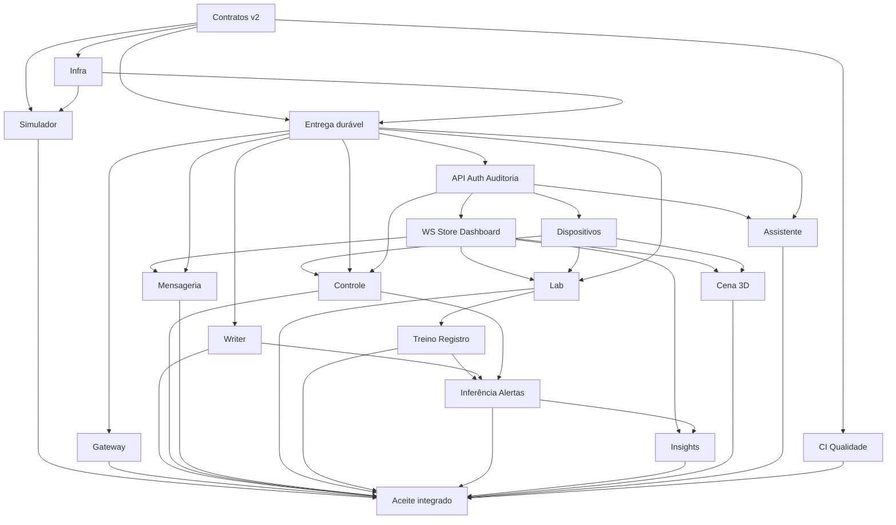

# Etapa 4 — Catálogo de módulos sob demanda

Base: `b266854`; branch documental `docs/plano-etapa-4-modulos`. Referências: [inventário](./01-inventario.md), [lacunas](./02-lacunas.md) e [arquitetura](./03-arquitetura.md). Não é cronograma, backlog ou autorização de implementação.

## 1. Como usar o catálogo

Os módulos são unidades de mudança com escopo e aceite próprios, não serviços novos automaticamente. Dependências são técnicas; a numeração serve de identificação e não determina calendário. Todos estão **pendentes de implementação/aceite AIoT**. [V] O M00 v1 existe, mas não corresponde à migração v2 proposta ([contracts.py:66](../../packages/smartfan_common/src/smartfan_common/contracts.py#L66)).

Cada pedido futuro implementa um módulo em branch própria, com contratos versionados e PR somente quando autorizado. O usuário autorizou merge local ao concluir; não autorizou push/PR. Se a base remota divergir ou houver alterações não commitadas, parar antes de mudar a branch. Não empilhar dependência não mergeada silenciosamente.

### Níveis de evidência

| Nível | O que comprova | O que não comprova |
|---|---|---|
| Unitário | Regra/algoritmo com entradas controladas e relógio injetado | Rede, broker ou banco real |
| Contrato | Python/JSON Schema/TS concordam e recusam inválidos | Autorização de transporte ou entrega |
| Integração | Adaptador conversa com dependência real e recupera falhas ensaiadas | Todos os fluxos até navegador |
| E2E | Ação do usuário atravessa os serviços e retorna efeito observado | Capacidade fora do perfil medido |
| Aceite operacional | Fluxos reais, falhas e metas com evidência identificada | Vida útil de hardware não calibrado |

Stubs usam os mesmos schemas, fixtures e relógio determinístico, são explícitos em testes e só entram em profiles/testes locais. Nunca ativar stub automaticamente após falha real. Evidência registra `real` ou `stub`, commit, versão, entrada e resultado. UI final não mostra dado de stub como sensor/IA real. Módulo com adaptador externo não recebe aceite de integração baseado apenas em fake.

## 2. Definition of Done comum — D0

Todos os módulos referenciam D0, sem repetir sua lista:

| Área | D0 verificável |
|---|---|
| Escopo | Só mudança autorizada; requisitos e exclusões do módulo cobertos; sem alterar domínio por conveniência |
| Contratos | Schemas fechados, versões/unidades e fixtures atualizados; geração sem diff; compatibilidade negativa testada |
| Código | Ruff/mypy e ESLint/vue-tsc limpos nos componentes afetados; formatação limpa; locks reproduzíveis |
| Testes | Testes de risco relevantes e suítes afetadas passando; integração real quando o módulo tem I/O; não aceitar teste que só repete implementação |
| Segurança | Nenhum segredo novo; scan de diff/arquivos e histórico conforme política; auth/ACL negativos e redaction quando aplicável |
| Operação | Serviço: usuário sem root, health/readiness, shutdown, logs JSON/correlation_id, timeout/limite/reconexão; biblioteca/UI: contrato e estados pertinentes, sem health endpoint artificial |
| Documentação | README do módulo ou seção claramente identificada, configuração por nomes, como executar/testar, limites e falhas; atualizar índice e rastreabilidade |
| Evidência | Comando/ação, commit, ambiente, real/stub, resultado, duração, versões e limitações; dados sensíveis removidos |
| CI | Jobs aplicáveis verdes no commit revisado; sem CI remoto executado, registrar `[N]` e não declarar DoD remoto concluída |
| Git | Branch por módulo, Conventional Commits pequenos, autoria configurada preservada, revisão e merge local; push/PR somente com autorização |

Infra, bootstrap e biblioteca não devem criar página artificial só para satisfazer checklist. Segurança e qualidade pertencem a cada módulo desde seu início; M18 não é adiamento de controles essenciais.

## 3. Catálogo

Comandos e caminhos futuros nesta seção são **interfaces propostas**, não arquivos ou ferramentas já existentes. Suites mencionadas serão criadas no módulo indicado. Um bloco de módulo foi limitado a uma tabela compacta, destinada a caber em uma página textual; paginação física depende da exportação.

### M00 — Contratos v2 e pacote compartilhado

| Campo | Definição |
|---|---|
| Escopo | Dentro: envelope/conteúdos completos v2, rotas, unidades, fixtures, geração de JSON Schema/TS, features causais compartilhadas. Fora: broker, regras operacionais e treino. Preservar v1 sem aliases de RUL |
| Requisitos | 3–11 e 14–18 como contratos habilitadores; não satisfaz funcionalidades sozinho |
| Dependências/stubs | Sem módulo novo obrigatório; código M00 v1 é base [V]. Stubs de relógio, eventos e modelos somente para contrato |
| Arquivos estimados | `packages/smartfan_common/src/smartfan_common/{contracts,features,routing}/`, schema/fixtures/tests, exportador e tipos/validador frontend; revisar imports sem migrar transporte silenciosamente |
| Aceite | Rodar pytest do pacote, exportação `--check`, testes AJV e geração TS: mesmos válidos/ inválidos em ambas as linguagens; rejeitar labels live, RUL antiga, duplicidade de campos ausentes e rota incompatível |
| Testes | Unitário de tempo/features; contrato Python↔schema↔TS; equivalência batch/online, passado-only, ordenação, boot e warmup |
| Risco/mitigação | Renomear semântica silenciosamente: nova versão, fixtures v1 preservadas e teste de incompatibilidade. D0 obrigatório |

### M01 — Infra base, Compose e segredos

| Campo | Definição |
|---|---|
| Escopo | Dentro: imagens pinadas, redes/volumes, bootstrap de segredos/topologia, healthchecks e usuário não-root. Fora: implementar consumidores de negócio ou treinar modelo |
| Requisitos | 4, 10, 11, 18–20 como infraestrutura |
| Dependências/stubs | M00 para topologia; imagem mínima de health pode substituir serviço ainda não implementado apenas no teste de infraestrutura. Compose final sem placeholders/stubs |
| Arquivos estimados | Compose, Dockerfiles, `.dockerignore`, `infra/`, `tools/bootstrap/`, `.env.example`, regras de ignore; permissões e secrets gerados só localmente |
| Aceite | Bootstrap duas vezes não sobrescreve segredo; `docker compose up --build` sem profiles sobe o conjunto disponível; `compose ps` saudável; inspeção de usuário/portas; publish/consume fora de ACL falha. Futuro serviço ausente é marcado pendente, não saudável por stub |
| Testes | Integração de subida, readiness sem ciclos, ACL negativa, bootstrap idempotente, volume preservado no restart; scan de imagens |
| Risco/mitigação | Imagem/UID/quorum incompatíveis: pin e smoke por versão. Primeiro download separado do tempo de boot. D0 obrigatório |

### M02 — Entrega durável e infraestrutura de dados comum

| Campo | Definição |
|---|---|
| Escopo | Dentro: adapters inbox/outbox/retry/lease/quarentena PG, migrações comuns, logs/health auxiliares. Fora: modelo Device/auth, schema de negócio e broker novo |
| Requisitos | 4, 10, 11, 19; base de recuperação dos demais fluxos |
| Dependências/stubs | M00; M01 para integração PG/AMQP. Banco/clock fakes liberam testes unitários, não aceite de commit/ACK |
| Arquivos estimados | Subpacote `smartfan_common/reliability/` com dependências opcionais de transporte e imports separados das features; migrações comuns; testes de integração |
| Aceite | Injetar queda antes/depois de commit e confirm: evento aceito reaparece, efeito único, retry conserva ID/hash, ID igual com payload diferente é recusado; PG offline pausa ACK; quotas não descartam pendências; lease perdido bloqueia efeitos e novo dono até confirmar parada do antigo |
| Testes | Unitário de backoff/lease/quota; contrato de falha; integração real de crash windows, concorrência, DLQ e reconciliação por IDs |
| Risco/mitigação | Biblioteca virar framework amplo: apenas primitivas necessárias, sem copiar loops entre serviços. D0 obrigatório |

### M03 — Simulador Python HVAC

| Campo | Definição |
|---|---|
| Escopo | Dentro: cinco sensores, dois atuadores, dinâmica térmica simples, desgaste, estado/ACK e spool SQLite. Fora: labels live, diagnóstico real e circuito refrigerante completo |
| Requisitos | 4–9; habilita 7, 14, 17 |
| Dependências/stubs | M00; M01 para MQTT real. Gateway pode ser substituído por cliente de receipt válido no teste isolado; M04 necessário no aceite ponta a ponta |
| Arquivos estimados | `services/simulator/`, config sem segredo, fixtures/cenários, testes e README; documentação do firmware marcada legado, sem apagá-lo |
| Aceite | Perfil healthy/degrading com seed fixa: >=3 variáveis mudam progressivamente; comando altera estado e leituras; OFF de ventilador bloqueia compressor; repetição retorna mesmo ACK; restart recupera spool e não executa comando vencido |
| Testes | Unitário de dinâmica/relógio/intertravamentos; contrato de payload sem labels; integração MQTT, LWT, spool e perda de receipt |
| Risco/mitigação | Dado perfeito ou calor confundido com falha: variabilidade por máquina e cenários saudáveis sob carga. D0 obrigatório |

### M04 — Gateway MQTT↔RabbitMQ

| Campo | Definição |
|---|---|
| Escopo | Dentro: validar origem/tópico/envelope, inbox/outbox, receipt, LWT observado, comandos/ACK e expiração. Fora: gravar Influx ou decidir termostato |
| Requisitos | 4, 9, 10 |
| Dependências/stubs | M00–M02; M03 pode ser cliente MQTT fixture. Aceite integrado usa simulador real |
| Arquivos estimados | `services/gateway/`, adapters MQTT/AMQP, testes de ACL/rota/recovery e README |
| Aceite | Publicar evento MQTT válido: receipt só após commit durável e evento chega à fila correta; broker/PG cai: sem confirmação falsa; comando AMQP chega ao dispositivo certo, ACK volta; replay vencido não executa |
| Testes | Unitário de identidade/rota/frescor; contrato; integração real dos dois brokers com queda entre PG, publish e confirmação |
| Risco/mitigação | PUBACK confundido com efeito físico: estados de transporte e comando separados; inferir indisponibilidade por LWT sem falsificar horário. D0 obrigatório |

### M05 — Writer InfluxDB e histórico HVAC

| Campo | Definição |
|---|---|
| Escopo | Dentro: gravação determinística HVAC/qualidade, confirmação persisted e acesso histórico agregado compartilhável. Fora: treino, snapshot WS e apagar histórico legado |
| Requisitos | 10–12; habilita 16–17 |
| Dependências/stubs | M00–M02; telemetria fixture pode substituir M03/M04. Cliente Influx fake só no unitário; aceite usa banco real |
| Arquivos estimados | `services/writer/`, adapters/query helpers no pacote, migrações de chave de ponto, testes e README; adaptar métricas sem alterar semântica energética |
| Aceite | Reentregar amostra: um ponto lógico; colisão de outro ID no mesmo ponto é preservada como falha; Influx offline não gera persisted; retorno escoa pendência; nulo não vira zero; ensaio isolado 1 M com contagem correta |
| Testes | Unitário de mapping/tipos; integração de duplicata e queda entre Influx e PG; regressão de energia/lacunas; consulta/paginação real |
| Risco/mitigação | Upsert sobrescrever field indevido: chave reservada e hash estável; UUID em field não é dedupe sozinho. D0 obrigatório |

### M06 — API, autenticação, papéis e auditoria

| Campo | Definição |
|---|---|
| Escopo | Dentro: `/api/v1`, erros padronizados, JWT/sessões, três papéis, bcrypt, login limitado, Alembic/seed e auditoria; shell/login Vue. Fora: implementar negócio de todos os módulos |
| Requisitos | 1, 2, 11, 19–20 e segurança transversal |
| Dependências/stubs | M00–M02; consultas/jogos/atuadores podem ter adapters fake retornando estado indisponível, sem produzir dados como reais |
| Arquivos estimados | Backend `auth`, `audit`, `errors`, `dependencies`, migrations; frontend router/shell/login/auth client; tests e README |
| Aceite | Login dos três papéis, 401/403 negativos, logout/expiração revogam sessão; rate limit 429; senha não aparece no log/resposta; migration sobre cópia do legado preserva registros; erro tem correlation_id |
| Testes | Unitário de claims/senhas/clock; API/integrado PG real; e2e login e guards; autorização server-side por recurso/campo |
| Risco/mitigação | Guard frontend virar única proteção: matriz de endpoint testada na API; seed sem senha fixa. D0 obrigatório |

### M07 — WebSocket, store e dashboard

| Campo | Definição |
|---|---|
| Escopo | Dentro: ticket único, consumidor q.events.api, snapshot autorizado, store por ID, reconexão e dashboard HVAC/histórico. Fora: 3D e cálculo de previsão no browser |
| Requisitos | 1, 3, 12; habilita 14 e 17 |
| Dependências/stubs | M00–M02/M06; M05 para histórico e M13 para frames no aceite integrado. Eventos de frame válidos podem liberar UI isolada |
| Arquivos estimados | Backend `realtime`, snapshot/metrics, frontend `stores`, composable WS, Dashboard e componentes; tests |
| Aceite | Segundo uso do ticket falha; socket não autenticado fecha em 5 s; assinatura não vaza outro recurso; frame atualiza dashboard; >6 s sem amostra marca sem dados; backlog não se torna leitura atual |
| Testes | Contrato de frame; integração WS/AMQP; Vitest com relógio fake; Playwright de reconnect, logout e histórico preservado |
| Risco/mitigação | Confundir conexão com sensor online: presença/última amostra/idade separados. D0 obrigatório |

### M08 — Cadastro e gestão de dispositivos

| Campo | Definição |
|---|---|
| Escopo | Dentro: dispositivo, sensor_id/actuator_id, capacidades, faixa saudável, configuração versionada e desativação lógica; UI Dispositivos. Fora: regra termostato e posição 3D no banco |
| Requisitos | 5–7, 11, 13 |
| Dependências/stubs | M00–M02/M06; estado observado fixture pode representar dispositivo offline; hardware/simulador não bloqueia cadastro |
| Arquivos estimados | Backend `devices`, ORM/migrations, frontend Dispositivos/formulários, tests e README |
| Aceite | Admin cria/edita/desativa; ID duplicado 409; operador não altera cadastro; histórico continua consultável após desativação; comando para desativado é recusado; IDs consumíveis pela cena |
| Testes | API/PG real, unicidade/migration, validação por tipo/unidade e autorização; e2e formulário/erros |
| Risco/mitigação | Misturar cadastro com estado físico: campos separados; remover dispositivo não apaga histórico. D0 obrigatório |

### M09 — Regras automáticas e comandos manuais

| Campo | Definição |
|---|---|
| Escopo | Dentro: controle, termostato, agenda, prioridades, intertravamentos, outbox/ACK e status manual; UI de comandos. Fora: interpretar texto do LLM ou diagnosticar causa de falha |
| Requisitos | 6, 8, 9, 11 |
| Dependências/stubs | M00–M02/M06/M08; M03/M04 para efeito real; M07 para retorno live. Fixtures de telemetria e ACK permitem testes isolados |
| Arquivos estimados | `services/control/`, backend `commands/rules`, migrations, controles Vue, tests e README |
| Aceite | Temperatura cruza faixa: compressor muda por regra; botão Web altera ventilador; desligá-lo impede refrigeração até liberação; repetir Idempotency-Key não duplica intenção; comando aplicado confirma só com ACK e aparece nas leituras |
| Testes | Unitário com clock de histerese/ciclos/prioridade; integração PG/AMQP/MQTT; e2e completo nos dois sentidos e falha/timeout |
| Risco/mitigação | Automático desfaz manual silenciosamente: bloqueio manual explícito, razão e revisão; timeout não prova não execução. D0 obrigatório |

### M10 — Página Mensageria e DLQ

| Campo | Definição |
|---|---|
| Escopo | Dentro: adaptador management backend, filas/taxas/consumidores, prévias redigidas, DLQ e replay restrito. Fora: navegador no broker ou Docker socket |
| Requisitos | 10, 11 |
| Dependências/stubs | M01/M02/M06/M07; broker fake para layout; integração usa management real e consumidor M05 ou fixture com mesma fila |
| Arquivos estimados | Backend `messaging`, frontend Mensageria, failure/audit endpoints e tests/README |
| Aceite | Parar consumidor real: fila cresce; voltar: esvazia sem duplicar efeito; UI corresponde a management; ver DLQ não consome mensagem; replay vencido não aciona atuador; credenciais nunca chegam ao navegador |
| Testes | API de permissões e redaction; integração Rabbit management/DLQ; Playwright sem usar sleeps fixos para sincronização |
| Risco/mitigação | Monitoramento drena fila ou expõe segredo: journal de prévias, cache/timeouts e acesso administrativo. D0 obrigatório |

### M11 — Laboratório de dados sintéticos

| Campo | Definição |
|---|---|
| Escopo | Dentro: config UI, job AMQP, NumPy em blocos, seed/manifesto/hash, rótulos isolados, amostra lab e progresso/cancelamento. Fora: treino e verdade latente no live |
| Requisitos | 7, 10, 15 |
| Dependências/stubs | M00–M02/M06/M07/M08; física/cenários compatíveis com M03 e features compartilhadas; sem depender do processo simulador rodando. Influx lab opcional para amostra, não para concluir artefato |
| Arquivos estimados | Worker jobs `lab`, backend `datasets/jobs`, frontend Laboratório, manifest schema, tests e README |
| Aceite | Configurar equipamento/sensores/dias/falhas/ruído/faltantes/outliers/seed; gerar >=1 M vetores e não fields; mesma config/versão reproduz hash; teto recusa excesso; cancelar não cria dataset completo; labels não aparecem em MQTT/WS |
| Testes | Unitário estatístico de degradação e censura; contrato de config; integração job/PG/volume; benchmark 1 M e e2e progresso/cancelamento |
| Risco/mitigação | OOM/artefato parcial: blocos, quota, escrita temporária+rename, contagem/hash e lease de recurso. D0 obrigatório |

### M12 — Treino, avaliação e registro de modelos

| Campo | Definição |
|---|---|
| Escopo | Dentro: dois alvos/regressores, baseline, split por máquina, métricas/gráficos/importância, registro e promoção; UI Treinamento. Fora: inferência operacional e criar alvos artificiais de censurados |
| Requisitos | 10, 16 |
| Dependências/stubs | M00–M02/M06/M07/M11; dataset pequeno fixo libera teste funcional, mas não substitui treino com massa final |
| Arquivos estimados | Worker `training/registry`, backend models/training-jobs, frontend Treinamento, model cards, tests e README |
| Aceite | UI dispara job; demonstrar IDs disjuntos e ausência de futuro; ambos alvos têm MAE/RMSE/R², scatter/importância/baseline; candidato inferior não promove; versão e hashes registrados; métrica indefinida não vira valor fictício |
| Testes | Unitário de split/leakage/promoção; integração job/artefatos; teste de reprodutibilidade com tolerância documentada e benchmark real |
| Risco/mitigação | Modelo aprende gerador/seed ou testa até vencer: features auditadas, seeds/cenários de avaliação separados e teste reservado. D0 obrigatório |

### M13 — Inferência, hot-reload e alertas preditivos

| Campo | Definição |
|---|---|
| Escopo | Dentro: janela online, recuperação passada, frames/insights, troca atômica, qualidade, histerese preditiva em controle. Fora: novo gerador e retreino automático por drift |
| Requisitos | 3, 10, 16, 17 |
| Dependências/stubs | M00–M02/M05/M09/M12; modelo fixture assinado pelo teste isola reload, mas aceite exige dois modelos treinados reais. UI pode vir depois |
| Arquivos estimados | `services/inference/`, extensão preditiva do controle, model activation, tests e README |
| Aceite | Telemetria persistida produz frame com origem/versão; ausência de modelo emite status, não RUL inventada; modelo aprovado/desired entra sem restart; evento sem aprovação ou de revisão antiga não ativa; hash incompatível mantém antigo; 3 previsões ativam e 10 recuperadas limpam alerta; dado stale não limpa nem anima |
| Testes | Unitário causalidade/ordem/histerese; contrato; integração Influx/AMQP/reload/crash; teste de reconciliação de resultados por evento-fonte |
| Risco/mitigação | Previsão antiga com aparência atual: carimbar evento-fonte/idade/modelo; reconstruir só passado e abster-se no warmup. D0 obrigatório |

### M14 — Página Insights

| Campo | Definição |
|---|---|
| Escopo | Dentro: saúde, RUL, tendência, alertas, qualidade, versões e comparação por equipamento; histórico autorizado. Fora: prever no browser ou converter horas de operação em calendário por alias |
| Requisitos | 12, 17 |
| Dependências/stubs | M06–M08 e contratos M00; M13 no aceite integrado. Frames fixture cobrem estados vazio/indisponível |
| Arquivos estimados | Frontend Insights/componentes e consultas backend de leitura, tests e README |
| Aceite | Falha injetada muda indicadores/alertas via stream real; parada marca dados antigos; versão ativa é a do frame, não a desejada; unidade RUL e escala simulada são visíveis |
| Testes | Vitest de estados/formatação; API de acesso; Playwright com frames reais e fixture para falhas raras |
| Risco/mitigação | Falsa precisão e ausência confundida com saúde: números só em status válido, motivo/idade sempre acessíveis. D0 obrigatório |

### M15 — Cena 3D

| Campo | Definição |
|---|---|
| Escopo | Dentro: Three.js procedural, IDs cadastrados, sensores/atuadores/equipamento, dois efeitos ambientais, cores, painel e congelamento. Fora: simulação física autônoma no navegador |
| Requisitos | 14; visualiza 5–9 e 17 |
| Dependências/stubs | M00/M06–M08; M09/M13 para comandos e cores IA integrados. WS fixture válida pode liberar geometria e teste de stale |
| Arquivos estimados | Frontend `scene/`, página Cena3D, painel/minigráfico e tests/README; sem gravar posição 3D no banco |
| Aceite | Todos IDs aparecem; atuador animado só ligado/fresco; vibração controla tremor; temperaturas interna/externa mudam ambiente; clique/teclado abre painel; parar simulador congela em <=6 s; não reconstruir objetos por mensagem |
| Testes | Unitário mapping/estado com clock; Playwright de painel/sem dados/reduced-motion; perfil GPU/FPS com métricas reais na máquina |
| Risco/mitigação | Cena pesada ou animação enganosa: budgets da arquitetura, instâncias, descarte e freeze explícito; alternativa textual. D0 obrigatório |

### M16 — Assistente LLM local

| Campo | Definição |
|---|---|
| Escopo | Dentro: Ollama/container/init, resumo autorizado, POST SSE, cancelamento, Markdown seguro, limites/auditoria e lease com jobs. Fora: cloud, SQL arbitrário, tools e comando por texto |
| Requisitos | 18; consulta 12 e 17 |
| Dependências/stubs | M01/M02/M06; consultas reais de M05/M08/M13 no aceite. Stream fake permite testar parser, sem satisfazer requisito de LLM local |
| Arquivos estimados | Backend assistant/resource lease, frontend Assistente, config Ollama/init, tests e README; secrets nunca no prompt |
| Aceite | Sem rede externa após cache, responder sobre falha/dados autorizados; streaming chega incremental; cancelar encerra upstream; job pesado descarrega modelo e chat informa indisponibilidade; injeção não executa ações; medir TTFT quente/frio |
| Testes | Unitário de resumo/limites/parser; integração Ollama real CPU; e2e SSE/Markdown/cancelamento; cenário de concorrência com job |
| Risco/mitigação | OOM/lentidão/hallucinação: modelo pequeno/contexto limitado, uma requisição, fontes/idade e benchmark antes de fixar candidato. D0 obrigatório |

### M17 — CI e qualidade transversal

| Campo | Definição |
|---|---|
| Escopo | Dentro: workflow por caminhos/risco, lint/tipos/testes/build/scan, pre-commit, gitleaks e evidências. Fora: esconder falhas históricas com allowlist genérica ou alterar permissões remotas sem autorização |
| Requisitos | 19–20 e verificações transversais |
| Dependências/stubs | Manifestos atuais [V] e contratos M00; pode existir antes dos serviços novos. Jobs de serviços ausentes são não aplicáveis, não falsos verdes |
| Arquivos estimados | `.github/workflows/`, `.pre-commit-config.yaml`, configuração de cobertura/scan, ferramentas de smoke, tests e documentação |
| Aceite | PR de teste com erro de tipo/segredo/contrato quebrado falha no gate correspondente; execução válida passa por lint→testes→build→scan; logs redigidos; histórico integral é analisado e achados tratados |
| Testes | Testes do workflow em branch quando autorizado; unitários/integração/e2e por escopo; validação negativa dos gates |
| Risco/mitigação | Workflow caro ou verde sem testar: seleção explícita e gate agregador que falha se job obrigatório faltar. D0 obrigatório; execução remota depende de autorização de publicação |

### M18 — Aceite integrado, hardening e README

| Campo | Definição |
|---|---|
| Escopo | Dentro: três fluxos, falhas, segurança/configuração final, backup/restore, metas, acessibilidade e execução documentada. Fora: adicionar stack ou declarar pronto só por teste unitário |
| Requisitos | 1–20, reconciliação final de evidências |
| Dependências/stubs | Todos os módulos pertinentes; stubs proibidos para aceite final. Ferramentas de observação não podem substituir serviço real |
| Arquivos estimados | Tests e2e/integração, scripts smoke/backup/restore, README raiz/aplicação, docs de operação; ajustes mínimos nos módulos responsáveis conforme falhas descobertas |
| Aceite | Compose real sobe; cumprir roteiro/metas da etapa 5, filas crescem/esvaziam e cena congela; restaurar em volumes isolados, reconciliar IDs, confirmar zero efeito duplicado e segurança negativa; relatório por commit |
| Testes | E2E crítico, carga, crash/recovery, restore, acessibilidade manual/automática e scans; nenhuma meta declarada atingida sem medição |
| Risco/mitigação | Ajuste transversal virar PR gigante: correções relevantes retornam ao módulo/branch próprio; M18 consolida evidência. D0 obrigatório |

## 4. Dependências reais e grafo

O grafo mostra dependências principais de código/contrato. Dependências de execução e alternativas stub estão nas fichas; não é ordem de desenvolvimento. M17 atua transversalmente, e M18 precisa do conjunto integrado. Não há aresta M18→módulo: correção encontrada no aceite não cria ciclo de dependência.



Exemplo de trabalho independente: Cena 3D pode ser construída com frame fixture validado após fechar contratos; recebe aceite de geometria/estado, mas só recebe aceite integrado quando M03–M07/M09/M13 estiverem reais. Assistente pode testar stream fake e resumo antes do modelo local, mas requisito 18 permanece pendente. Infra pode existir antes do auth, sem alegar que sua API já está protegida.

## 5. Contratos mínimos a fechar antes de consumidores

Todos os exemplos são didáticos e estáticos; não são leituras/credenciais reais. Datas antigas são válidas estruturalmente, mas um comando com elas está expirado em execução posterior. Testes usam relógio explícito. M00 é dono do wire/schema; M02 da entrega; o módulo de domínio é dono das regras semânticas. Mudança incompatível exige versão e fixtures coordenadas.

| Contrato | Dono | Exemplo concreto e condição de aceite |
|---|---|---|
| Envelope/conteúdo | M00 | Exemplo de telemetria abaixo; schema 2.0 fechado e união por tipo; nunca aceitar só envelope com conteudo livre |
| MQTT | M00/M03/M04 | `devices/ac_01/telemetry` QoS1/no-retain; `devices/ac_01/commands` QoS1/no-retain; state/availability retained; usuário simulator_ac_01 não escreve ac_02 |
| Routing keys | M00/M01/M04 | events `telemetry.quarto.hvac.ac_01`→q.telemetry.writer/q.control; `persisted.quarto.hvac.ac_01`→q.inference; `command.ac_01`→q.commands.gateway; `frame.ac_01`→q.events.api; jobs `job.train`→q.jobs.train; rota sem binding falha |
| Influx | M00/M05 | Line protocol abaixo; ID/boot/modelo são fields, ponto usa measurement+tags+timestamp preservados; colisão de outro evento não sobrescreve |
| PostgreSQL | M02/M06/M08/M09 | Device `ac_01`, sensor `ac_01_current`, atuador `ac_01_compressor`; comando id único, revisão 12, usuário UUID e status pendente; device_id único, revisão por dispositivo única e FK válida |
| Erro HTTP | M06 | Exemplo problem+json abaixo; status HTTP concorda com corpo, sem stack/segredo, correlation_id presente |
| Comando/ACK | M00/M04/M09 | command_id igual ao ID da intenção; ACK aponta esse ID e revisão; alvo boot/expiry; repetições não repetem efeito físico; exemplo completo na arquitetura |
| Eventos WS | M00/M07/M13 | Frame abaixo; source_event_id é ID da amostra bruta, causation_id aponta o evento imediatamente anterior; consumidor filtra autorização/ordem/frescor no servidor |
| Tempo | M00/M03/M04 | Amostra timestamp `2026-11-08T22:00:00Z`, observed_at igual no exemplo, clock_scale=1 obrigatório no live; acelerar somente degradação, sem alterar timestamps, janelas ou expiração |
| Features/modelos | M00/M12/M13 | feature_version `hvac-window-v1` com ordem explícita; `rul_calendar_hours: 24.5` só em schema2.0; recusar artefato com `rul_operating_hours` ou features incompatíveis |
| Jobs/manifesto | M00/M11/M12 | `job_id`/`dataset_id` UUID, seed 42, 30 equipamentos, 1 M vetores, arquivo/hash completos; job só completed após validação; leitura de referência a config imutável no PG |

### 5.1 Telemetria v2

```json
{
  "id": "11111111-1111-4111-8111-111111111111",
  "schema_version": "2.0",
  "timestamp": "2026-11-08T22:00:00Z",
  "tipo": "telemetry.sampled",
  "dispositivo": "ac_01",
  "correlation_id": null,
  "metadata": {
    "producer": "simulator", "causation_id": null,
    "boot_id": "33333333-3333-4333-8333-333333333333",
    "sequence": 120, "zone": "quarto", "equipment_type": "ac_split_onoff", "clock_scale": 1
  },
  "conteudo": {
    "readings": {"current_a": 4.2, "compressor_case_temp_c": 58.0, "vibration_rms_mm_s": 1.2, "indoor_temp_c": 26.0, "outdoor_temp_c": 32.0, "power_w": 850.0},
    "actuators": {"compressor_on": true, "condenser_fan_on": true},
    "quality": {"missing_fields": []}
  }
}
```

Potência desse exemplo é saída ilustrativa do simulador, não cálculo/calibração validada. M00 exige limites e unidades coerentes; não inserir dado latente de falha em metadata nem readings. Para fechar a identidade sem ambiguidade: produtor serializa uma vez, persiste os bytes UTF-8 e seu SHA-256, e reenvia exatamente esses bytes. Gateway não altera a amostra ao encaminhá-la para AMQP; registra observed_at confiável no journal PG vinculado ao ID. Writer consulta esse carimbo e o inclui no evento persisted derivado, com ID novo; frame herda o mesmo carimbo. Assim, um ID nunca muda de hash por enriquecimento. Variação de whitespace com o mesmo ID também é conflito, não correção silenciosa. M00/M04 devem testar essa regra e preservar bytes originais para auditoria/retry.

### 5.2 Influx e PostgreSQL

Exemplo de ponto Influx (timestamp em nanossegundos, mostrado em linha separada apenas para leitura; futura serialização produz uma única linha):

```text
hvac_telemetry,device_id=ac_01,zone=quarto,equipment_type=ac_split_onoff current_a=4.2,compressor_case_temp_c=58.0,vibration_rms_mm_s=1.2,indoor_temp_c=26.0,outdoor_temp_c=32.0,power_w=850.0,compressor_on=true,condenser_fan_on=true,event_id="11111111-1111-4111-8111-111111111111",boot_id="33333333-3333-4333-8333-333333333333",sequence=120i 1794175200000000000
```

O mapping completo também grava received_at e qualidade; se o sensor é nulo, omitir field e registrar ausência, não zero. Campos de timestamp originais permanecem constantes na reentrega.

Exemplo lógico de registro relacional, não payload público irrestrito nem migration executada:

```json
{
  "device": {"device_id": "ac_01", "equipment_type": "ac_split_onoff", "zone": "quarto", "enabled": true},
  "sensor": {"sensor_id": "ac_01_current", "device_id": "ac_01", "kind": "current_a", "unit": "A"},
  "actuator": {"actuator_id": "ac_01_compressor", "device_id": "ac_01", "kind": "compressor"},
  "command": {"id": "44444444-4444-4444-8444-444444444444", "device_id": "ac_01", "actor_id": "55555555-5555-4555-8555-555555555555", "revision": 12, "status": "pendente"}
}
```

Migrações definem campos restantes, FKs, índices e defaults; exemplo não autoriza omitir user/expiry/request_hash do comando persistido. Status público pendente/confirmado/falhou é distinto de status interno detalhado, conforme arquitetura.

### 5.3 Erro de API

```json
{
  "type": "urn:smartfan:problem:device-offline",
  "title": "Dispositivo sem dados recentes",
  "status": 409,
  "detail": "Aguarde uma leitura atual antes de comandar.",
  "instance": "/api/v1/devices/ac_01/commands",
  "code": "device_offline",
  "correlation_id": "22222222-2222-4222-8222-222222222222"
}
```

### 5.4 Frame do WebSocket

```json
{
  "id": "66666666-6666-4666-8666-666666666666",
  "schema_version": "2.0", "timestamp": "2026-11-08T22:00:00Z",
  "tipo": "frame.ready", "dispositivo": "ac_01",
  "correlation_id": "22222222-2222-4222-8222-222222222222",
  "metadata": {"producer": "inference", "causation_id": "77777777-7777-4777-8777-777777777777", "boot_id": "33333333-3333-4333-8333-333333333333", "sequence": 120, "zone": "quarto", "equipment_type": "ac_split_onoff", "observed_at": "2026-11-08T22:00:00Z", "clock_scale": 1},
  "conteudo": {
    "source_event_id": "11111111-1111-4111-8111-111111111111",
    "telemetry": {
      "source_event_id": "11111111-1111-4111-8111-111111111111",
      "readings": {"current_a": 4.2, "compressor_case_temp_c": 58.0, "vibration_rms_mm_s": 1.2, "indoor_temp_c": 26.0, "outdoor_temp_c": 32.0, "power_w": 850.0},
      "actuators": {"compressor_on": true, "condenser_fan_on": true},
      "quality": {"missing_fields": []}
    },
    "insight": {"status": "valid", "model_version": "hvac-demo-001", "feature_version": "hvac-window-v1", "health_score": 72.0, "rul_calendar_hours": 24.5}
  }
}
```

Número de saúde/RUL é ilustrativo, não previsão produzida. Sem modelo: status model_unavailable, model_version null e valores null. Sem dados suficientes: status correspondente e nenhum valor numérico inventado. Frame não carrega health_true, rul_true, failure_at nem modo latente. Alertas chegam como eventos próprios e quadro de leitura mantém referência consistente ao evento-fonte.

## 6. Qualidade transversal

### 6.1 Pirâmide e ferramentas

[V] Ruff/mypy/pytest já estão configurados no [backend/pyproject.toml:1](../../web-smart-fan-iot/backend/pyproject.toml#L1), testes e lint frontend no [package.json:6](../../web-smart-fan-iot/frontend/package.json#L6), mypy strict no [pacote:25](../../packages/smartfan_common/pyproject.toml#L25). [V] `git ls-files .github '*pre-commit*'` não encontrou workflow/hook rastreado na base desta etapa. A estratégia abaixo é proposta, não CI já existente.

| Camada | Foco | Ferramentas/evidência |
|---|---|---|
| Muitas unidades rápidas | Energia, histerese, clocks, validação, split, retry, quotas, estados UI | pytest/Vitest, fixtures e relógio injetado, sem rede |
| Contratos compartilhados | Schema/JSON/TS, wire v1 versus v2, labels fora do live, eventos/rotas e unidades | pytest+AJV/Vitest, geração `--check`, mesmos casos válidos/inválidos |
| Integrações seletivas | Broker/banco/volume reais e janelas de falha | Compose de teste com nomes/volumes isolados; reconciliação por ID, não só HTTP 200 |
| Poucos E2E críticos | Login, fluxo sensor→UI, botão→ACK/leituras, dados→treino→insights e 3D congelado | Playwright com roles/test IDs, assertions com espera, trace em falha; sem screenshot como única prova |
| Ensaios operacionais | 1 M, consumidor parado, modelo quente/frio, restart e restore | Perfil de carga fixo, medição de RAM/latência/contagens; relatório por commit |

Metas de cobertura e performance são as da [arquitetura, seção 13](./03-arquitetura.md#13-metas-não-funcionais-mensuráveis), sem inventar porcentagens atuais. Coverage não substitui testes de falha e autorização. Playwright oferece assertions que aguardam condição, evitando sleeps arbitrários: [documentação de assertions](https://playwright.dev/docs/test-assertions).

### 6.2 Comandos e pipelines propostos

| Gate | Comandos/interfaces e resultado exigido |
|---|---|
| Python | `python -m ruff check`, `python -m ruff format --check`, `python -m mypy` nos pacotes/apps/serviços afetados; zero erro; pytest com cobertura de branches |
| Frontend | `npm ci`, `npm run lint`, `npm run format:check`, `npm run typecheck`, `npm test`, `npm run build`; scripts existentes adaptados sem declarar que cobrem páginas futuras |
| Contratos | Exportador Python e gerador TS por versão com `--check`; alteração gerada exige mesma fonte/fixture, sem edição manual |
| Hooks | pre-commit com Ruff, formatação, whitespace e scanner staged; `pre-commit run --all-files` no gate; hooks fixados por revisão, sem baixar versão flutuante |
| Segredos | Gitleaks em staged/arquivos e histórico integral com redaction; relatório identifica localização, nunca o valor; ferramenta fixada e comando conferido nessa versão |
| Integração | Suites por serviço usando volumes isolados e credenciais efêmeras; cleanup só do projeto de teste validado, nunca volumes reais |
| E2E | Playwright do fluxo crítico e acessibilidade automática; sem mock no ensaio final; screenshots/trace só com dados sintéticos e sem tokens |
| Build/scan | Imagens por digest, SBOM e scanner de vulnerabilidade; zero críticas abertas e relatório de dependências; sem publicar imagem em registry sem autorização |

GitHub Actions proposto: **lint/tipos/contratos/segredos → unitários+contrato → integração+E2E aplicáveis → build de imagens → scan → gate agregador**. Jobs independentes podem executar em paralelo dentro do gate; fluxo só passa se todos os checks obrigatórios concluírem. Build não publica imagem. Checkout com histórico suficiente para scanner; permissions contents:read por padrão; ações de terceiros pinadas por SHA. Relatórios/trace com retenção curta e sanitizados; não enviar segredos de produção a PR de fork. Cache não contém .env, modelos privados ou credenciais.

Dependências externas do CI (registry e download do modelo) têm tratamento explícito: indisponibilidade é gate não executado/bloqueado, não sucesso. Teste unitário do assistente usa stream fake; smoke Ollama local com modelo real deve ter runner/limite de recursos definido e evidência antes de liberar M16/M18. O scan crítico não é desligado para caber no CI.

Pre-commit complementa, não substitui CI nem revisão: [projeto pre-commit](https://pre-commit.com/). Scanner dedicado e suas flags serão pinados em M17; não presumir que uma heurística local certifica ausência de segredos.

### 6.3 Segredos históricos, autoria e política de PR

[V] O inventário encontrou atribuições históricas de POSTGRES_PASSWORD e INFLUXDB_TOKEN; [N] revogação não confirmada. Scan histórico não poderá simplesmente virar verde com allowlist ampla. Tratar achado por localização e motivo: confirmar revogação, remover valores ativos de uso, registrar risco residual sem copiar segredo e manter baseline de achados históricos precisamente delimitada quando não se reescrever histórico. Novo achado fora da baseline falha. Baseline não é prova de revogação nem autorização de reescrever Git; se a política exigida impedir publicação até resolver, declarar gate bloqueado e pedir decisão específica.

Conventional Commits (`feat`, `fix`, `docs`, `test`, `ci`, `chore` com escopo), commits pequenos e autoria da configuração real. Um módulo por branch/PR; aceite e D0 na descrição, evidências real/stub e pendências `[N]`. Contribuições dos integrantes devem corresponder a trabalho real e revisão identificável; não alterar autor, fabricar commits ou dividir artificialmente autoria para cumprir requisito acadêmico. Lista/contas dos integrantes ainda [N].

Proteção remota proposta: main sem force-push/deleção, checks obrigatórios, revisão de outro integrante quando houver equipe, aprovação desatualizada invalidada após mudança relevante e conversas resolvidas. Preferir merge commit para preservar commits originais de autoria. Não prometer que proteção garante participação: acompanhar evidência por integrante.

**Compatibilidade com o fluxo local autorizado:** nesta consolidação o agente conclui branch e faz merge local; não há push autorizado. Se a main remota exigir PR, não tentar publicar merge local diretamente como contorno. Publicar branch e abrir PR só após autorização; o merge remoto deve seguir a proteção e os checks. Se necessário, reconciliar a main local com o resultado remoto sem reset/force/rebase de histórico publicado por iniciativa própria. Política de PR deve ser definida antes de publicar os merges documentais locais. A exigência de review/checks é aplicada pelo GitHub conforme sua [documentação de branches protegidas](https://docs.github.com/en/repositories/configuring-branches-and-merges-in-your-repository/managing-protected-branches/about-protected-branches).

## 7. Premissas, pendências e limite desta etapa

| Tipo | Registro |
|---|---|
| Confirmado pelo usuário | Branch por alteração relevante, merge local ao concluir, documentação consolidada antes da implementação |
| [V] Base reaproveitável | M00 v1, API/energia, componentes Vue e suítes existentes; evidências no inventário, não funcionalidades AIoT concluídas |
| Proposta | 19 módulos compactos; serviços apenas os da arquitetura; M02 é pacote/adapters compartilhados, não daemon novo |
| [N] Ferramentas futuras | Entrypoints/suites por módulo, pre-commit, gitleaks, pipeline completo, Playwright e scanner de imagens ainda não implementados/validados |
| [N] Operação | Metas de latência/RAM/LLM, invariantes sob falha, restore e permissões reais precisam de execução na implementação |
| [N] Compatibilidade | Schema união completo v2, implementação da identidade/hash de bytes imutáveis, patches/digests e grants finais precisam de aceite nos módulos donos |
| [N] Organização | Configuração remota de proteção/CI, contribuições da equipe e aprovação acadêmica não confirmadas |

Próxima entrega: riscos, matriz requisito→módulo→teste→demonstração, checklist completo e roteiro de apresentação. Nenhum módulo deve ser iniciado antes de concluir e aprovar essa consolidação.
